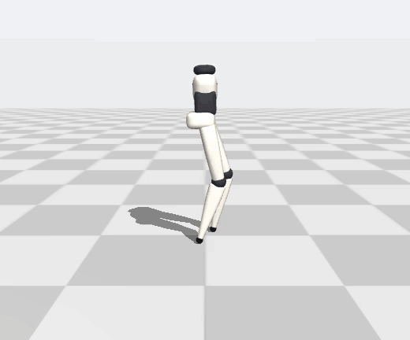
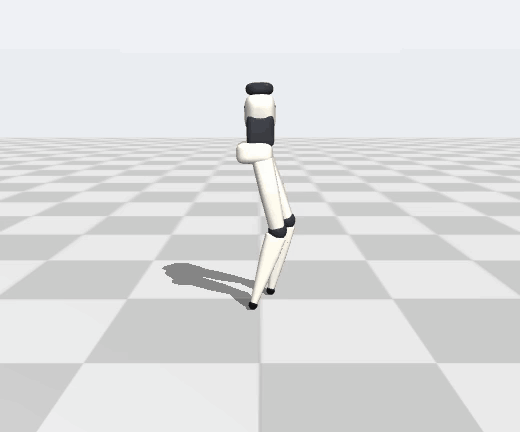
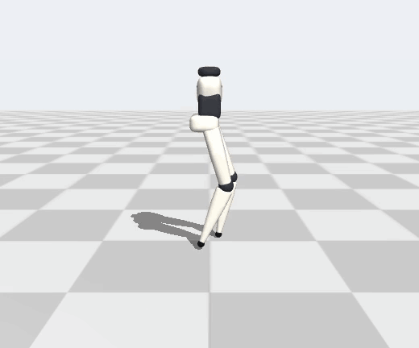
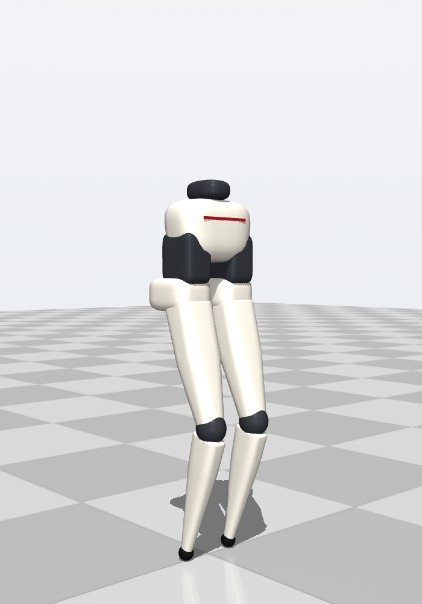
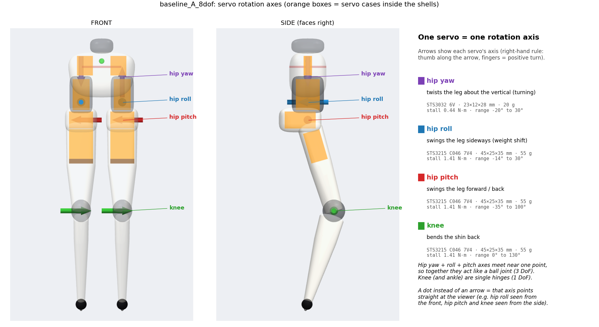
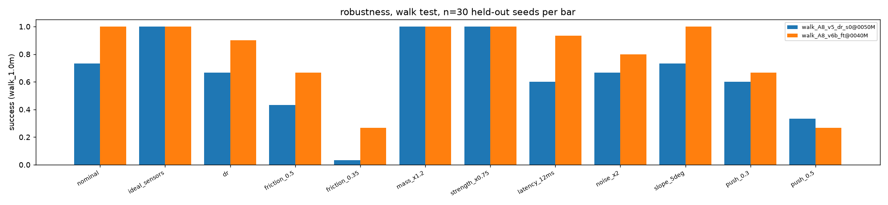

# Slender-leg biped: footless walking under hobby-servo limits

A 38 cm, 0.85 kg biped with narrow hips, tubular legs and **no feet**, just a 16 mm rubber ball at
the end of each shin (inspired by the Elster / Aigis silhouette). Eight off-the-shelf Feetech
servos (~$210 in total) drive it, each modelled with its real torque-speed curve, latency and
quantization. It is trained with GPU reinforcement learning (MuJoCo MJX + Brax PPO) and checked in
an independent CPU simulator.

**Question:** can this footless form factor stand and walk on hardware a hobbyist can buy, and which
design trade-offs actually matter?
**Answer, in simulation:** yes. It stands indefinitely, walks straight and stops on command, with
every servo below its rated torque. It never stands *still*, though: like a point-footed robot, it
balances by stepping in place.

> **Status (2026-10-23): simulation only.** No hardware has been built yet. All numbers come from
> held-out evaluation seeds. Simulated feasibility is not validated hardware capability.

<table>
<tr>
<th>Stand (zero command)</th>
<th>Walk (0.15 m/s command, heading hold)</th>
<th>Walk → stop → walk</th>
</tr>
<tr>
<td></td>
<td></td>
<td></td>
</tr>
</table>

<sub>One policy, `walk_A8_v6b_ft`. All three clips use evaluation seed 10000 (the first seed, not
cherry-picked), rendered in real time by <code>scripts/render_gif.py</code>.</sub>

## Results

One policy controls all three behaviours. It was selected by a rule declared in advance (highest
in-training evaluation reward), not by its test results. Each gate uses 100 held-out seeds in the
CPU simulator, with the full contact model and the servo model in the loop.

| gate | target | result |
|---|---|---|
| free stand ≥ 15 s | ≥ 70 / 100 | **100 / 100** (also 100 / 100 at 30 s) |
| walk ≥ 2 m without falling | ≥ 70 / 100 | **100 / 100** in a 40 s test: median 3.4 m, 0 falls, 3.8° heading drift |
| walk → stop → walk | ≥ 50 / 100 | **79 / 100** (speed 0.09 → 0.01 → 0.09 m/s) |
| servo load | within ratings | sustained RMS torque **0.61–0.82 × vendor rated** on every joint; duty saturated 0.4 % of the time; ≤ 2 over-speed events per 100 runs |
| geometry | hip ≤ 24–28 % of height, shin ≤ 9–12 % | hip 28.4 % (just over the target), shin **5.8 %**; every servo fits inside its shell with a 1.2 mm wall |

**Not solved yet:**
- It walks at 0.09 m/s against a 0.15 m/s command.
- It follows heading only through an outer IMU-yaw loop; it ignores open-loop turn commands.
- A 0.5 m/s push knocks it over in 80 % of runs.
- On a slippery floor (friction 0.35), only 27 % of runs make 1 m.

## Key learnings

1. **Servo speed, not torque, is the binding limit.** The 12 V STS3215 has twice the torque, but
   its 45 rpm knee allows only about 1 step/s, so it was rejected before training. Its 7.4 V
   sibling (106 rpm, same case) works, and trained policies still drive the knee to 95–100 % of its
   no-load speed. A slimmer Dynamixel hip set (XC330/XL330) stood (91 %) but went over speed 2,046
   times per 100 runs, against 1 for the Feetech design, at ~3.4× the cost.
2. **Point feet force dynamic balance.** Two point contacts give no support polygon. Every policy,
   for both tip shapes, balances by micro-stepping at 5–8 steps/s. Penalizing every footfall
   did not change that.
3. **Ball versus rocker made no difference.** With matched training budgets, the 16 mm ball (A) and
   the 32 × 13 mm rocker (B) tied on standing (99 % vs 99 % at 30 s) and on walking (85 % vs 92 %
   reaching 2 m). The preferred ball costs nothing.
4. **Hardware plausibility has to be trained in.** Without a sustained-torque penalty, the standing
   policy ran hip roll at 1.29 × rated torque. With the penalty it stayed ≤ 0.88 ×, and survival
   *rose* from 96 % to 99 %. Under a pessimistic thermal cap (0.25 × stall) it still stands 95 %
   of the time.
5. **Reward design and fine-tuning hygiene dominated the walking work.** Walking took six reward
   versions, summarized below:

   | version | outcome |
   |---|---|
   | v2 | stepped in place |
   | v3 | walked, but drifted ~80° off heading |
   | v4 | regressed |
   | v5 | walked straight but never stopped |
   | v6 | collapsed: the warm start re-initialized the critic |
   | v6b | passed every gate (critic restored, lower learning rate) |

   Long runs also regressed after ~50 M steps, so checkpoint selection has to be declared in advance.
6. **Traction and pushes are the next bottleneck, not strength.** A heavier robot (+20 % mass)
   and weaker servos (−25 % strength) barely matter. Low floor friction, doubled sensor noise and
   large pushes are where it breaks. Training with noise fixed the noise sensitivity (0.66 → 0.92);
   training with pushes did not fix pushes.

## The design

<p>


</p>

- **Per leg:** hip yaw (STS3032), hip roll, hip pitch and knee (STS3215-C046, 7.4 V); 8 DoF total.
  The yaw, roll and pitch axes meet near one point, so the hip acts like a ball joint.
- **Knee drive:** the knee servo sits in the thigh and drives the knee through a 1:1 belt, so the
  knee ball stays slim.
- **Dimensions:** thigh 138 mm, shin 150 mm, centre of mass 27 cm above the floor.
- **Shells:** the printed shells are a parametric superellipse shape, generated from
  `configs/geometry.yaml`. The packaging check confirms every servo case fits inside its shell.
- **Mass:** the simulator gets each part's mass and inertia (servos, shells, electronics), so the
  centre of mass and balance match the CAD estimate.

## How it works

- **Simulator:** MuJoCo 3.17. Training runs on the GPU with MJX and a lean contact set (4,096
  parallel environments). Evaluation runs in an independent CPU simulator with every contact pair
  and a more accurate solver.
- **Servo model:** in [`slender_biped/actuator.py`](slender_biped/actuator.py). Duty is clipped,
  then torque falls linearly with speed, as in a DC motor (stall torque × (1 − ω/ω₀)), with a
  current limit. It also models 4 ms bus latency, slew limiting, a position deadband and
  quantization, plus reflected rotor inertia (J·N²). Saturation and over-speed are logged, never
  hidden.
- **Policy:** PPO with an asymmetric actor-critic, running at 50 Hz with 2 ms physics steps.
  - The actor sees only signals a real robot has: IMU gravity and gyro, joint positions and
    velocities, last action, command and gait clock.
  - The critic also sees privileged simulator state.
- **Rewards:** velocity and heading tracking, a stop reward, upright and height terms, gait shaping,
  and hardware penalties for sustained torque, saturation and over-speed. Details are in
  [`slender_biped/mjx_env.py`](slender_biped/mjx_env.py).
- **Domain randomization:** tip friction, link masses, CoM, rotor inertia, gear friction, servo
  strength, speed and gain, latency, and backlash.
- **Evaluation:** a NumPy re-implementation of the policy, identical to Brax inference (max |Δa| = 0).
  Seeds 10000+ are never used in training.

## Ablations

Standing unless noted; 100 held-out seeds each.

| question | change | result |
|---|---|---|
| tip shape | rocker B vs ball A | 99 % vs 99 % alive at 30 s; walking 92 % vs 85 % reach 2 m. **No difference.** |
| thermal margin | sustained cap at 0.25 × stall | 95 % alive. **Stands under a pessimistic heat assumption.** |
| servo family | slim Dynamixel hips (24 % hip width) | 91 % alive, 2,046 over-speed events. **Speed-limited, ~3.4× cost.** |
| robust training | sensor noise ×1.5 + pushes | noise ×2 robustness 0.66 → 0.92; pushes not improved. **Trade-off.** |
| domain randomization | DR fine-tune | no robustness gain |
| reproducibility | training seed 1 vs seed 0 | 97 % vs 99 % alive at 30 s |
| quiet standing | penalize every footfall (A and B) | still 6.7 / 7.6 steps/s. **Never stationary.** |

Walking robustness, from 30 seeds per condition (share reaching 1 m in 20 s):

| nominal | mass ×1.2 | strength ×0.75 | 5° slope | latency 12 ms | sensor noise ×2 | friction 0.5 | push 0.3 m/s | friction 0.35 | push 0.5 m/s |
|---|---|---|---|---|---|---|---|---|---|
| 100 % | 100 % | 100 % | 100 % | 93 % | 80 % | 67 % | 67 % | 27 % | 27 % |



The full experiment trail is in [`docs/experiments.md`](docs/experiments.md): 21 training runs,
including the failures, corrections and dead ends.

## Reproduce

```bash
uv venv -p 3.12 .venv && uv pip install --python .venv/bin/python -r requirements.txt
.venv/bin/python models/generate_model.py && .venv/bin/python scripts/regen_train_models.py
.venv/bin/python -m pytest -q tests

# evaluate the included best policy on CPU (100 held-out seeds)
.venv/bin/python scripts/evaluate.py walk_A8_v6b_ft --test walk40 --n 100
.venv/bin/python scripts/render_gif.py walk_A8_v6b_ft --test walk40 --seconds 12 --out walk.gif

# train on a GPU (one job at a time; gpu_python.sh hides a system CUDA from LD_LIBRARY_PATH)
scripts/gpu_python.sh scripts/train.py --name my_walk --model baseline_A_8dof --task walk --steps 150e6 --dr
```

`runs/` keeps every run's config and learning curve. Weights are included only for the selected
policy (`walk_A8_v6b_ft`) and the checkpoint it was fine-tuned from.

## Repository map

| path | contents |
|---|---|
| `configs/` | parametric morphology (`geometry.yaml`); servo catalogue with sources and assignment sets (`actuators.yaml`) |
| `models/generate_model.py` | MJCF generator: exterior shells, servo envelopes, collision primitives, full and training contact sets |
| `slender_biped/` | servo model, MJX training env, CPU evaluator, morphology and statics tools, renderer |
| `scripts/` | training, evaluation, robustness sweeps, torque audit, renders, and the one-job-at-a-time GPU queue with a stall watchdog |
| `results/` | evaluation JSONs for every reported number; plots |
| `docs/` | [spec](docs/project_spec.md), [morphology](docs/morphology.md), [actuator research](docs/actuator_research.md) and [feasibility](docs/actuator_feasibility.md), [experiment log](docs/experiments.md), [sim-to-real risks](docs/sim2real_risks.md) |

## Limitations

- **Servo specs:** Feetech figures come from retailer listings. Rotor inertia, gear friction and
  the "rated" torque are estimates, and thermal behaviour is unverified.
- **Contact model:** contacts are MuJoCo soft constraints. Real rubber tips, floor compliance and
  belt backlash will differ.
- **Walking reproducibility:** walking was trained with only one seed. Standing reproduced across
  seeds; walking variability is the main untested uncertainty.
- **Post-hoc result:** an earlier walking result (v5 at 30 M steps, 86 % reaching 2 m) was picked
  after looking at its test results and is labelled as post hoc in the log. The headline numbers
  above use the declared rule only.
- **Next steps:** explicit turning, speed tracking and push recovery, then bench tests of the servo
  torque-speed curve, tip friction and IMU noise before building hardware.
  [`docs/sim2real_risks.md`](docs/sim2real_risks.md) lists the risks in order.
