# Slender-leg biped: can an ankle-less, footless robot leg balance and walk?

An end-to-end robotics design study:
1. **Concept:** a novel leg concept from character art.
2. **Physical model:** built from off-the-shelf servos with realistic mass, packaging and motor
   limits.
3. **Training:** GPU-trained reinforcement-learning policies.
4. **Validation:** an independent evaluation that tests whether the design actually works.

<table>
<tr><th></th><th>Stand (zero command)</th><th>Walk (0.15 m/s command)</th></tr>
<tr>
<th>Ball tip<br><sub>original concept</sub></th>
<td valign="top"><br><sub>balances by micro-stepping</sub></td>
<td valign="top"></td>
</tr>
<tr>
<th>30 mm flat pad<br><sub>same leg, flat tip</sub></th>
<td valign="top">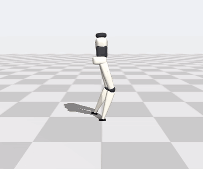<br><sub>stands still</sub></td>
<td valign="top">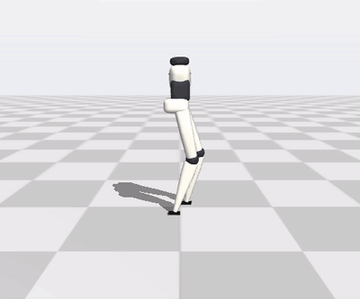</td>
</tr>
<tr>
<th>As built<br><sub>model from the printed CAD<br>and the real servos (§6)</sub></th>
<td valign="top">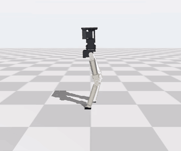<br><sub>stands still and recovers from 0.3 m/s shoves</sub></td>
<td valign="top">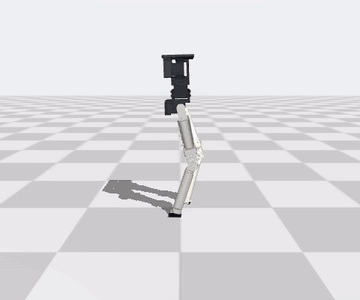<br><sub>real steps, narrow "catwalk" track (§7)</sub></td>
</tr>
</table>

<p><b>Real hardware:</b> the printed P0 left leg (§5), bench-tested on a 5 V supply: sit-up on its own pad, kick, hip yaw.</p>
<p>
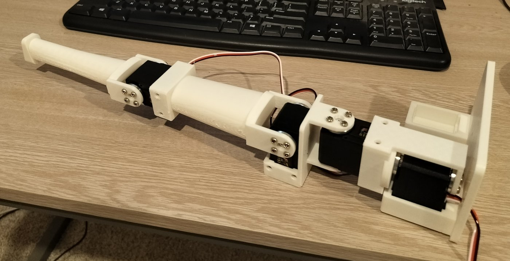
</p>
<p>
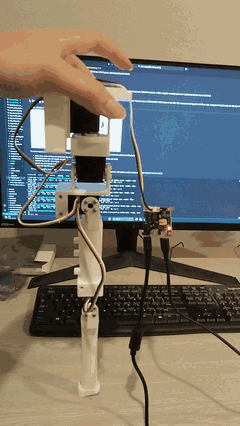
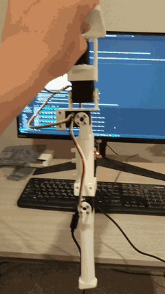
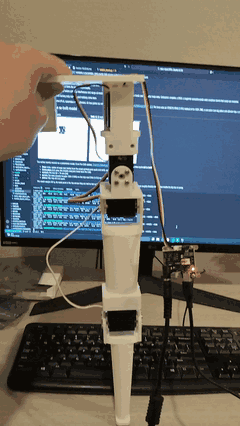
</p>

**TL;DR**
- **The ball-tip design works dynamically.** A 38 cm, 0.85 kg biped on two 16 mm rubber balls,
  driven by eight off-the-shelf hobby servos (~$180 in total), stands indefinitely, walks straight and stops on command in
  simulation, with every servo inside its ratings.
- **It can never stand still.** It balances by micro-stepping about 6 times a second, under every
  reward and control variant I tried, including ideal sensors and 100 Hz control.
- **Feet are not the whole story.** Control experiments show that any flat contact removes the
  stepping. An ankle is not needed. Feet did not, however, fix the short walking steps.
- **A 30 × 18 mm flat pad at the shin tip is a viable compromise.** It keeps the silhouette and
  stood without lifting a tip in 85 % of runs. Training found that stance on 1 of 2 seeds.
- **The as-built robot works too (§6).** Retrained on a model generated from the printable CAD and the servos
  actually bought, it stands still (98 % without lifting a pad), survives shoves, and walks at 0.18 m/s while
  stopping on command 98 % of the time. Walking draws about 1.5 A at 7.4 V, with ~9 A peaks.
- **Real steps instead of a skitter (§7).** Every earlier walker took 5–7 tiny hops a second (2 cm, 60 ms in the
  air). Imitating a reference gait, with more double support, gives a straight walk with 6 cm steps, 160 ms of
  swing and 2 cm of foot clearance at 0.16 m/s, reproduced on 2 of 2 seeds; a curriculum narrows it into an
  elegant catwalk line. The cost: ~2.2 A instead of 1.5 A, with the hip servos at their rated torque.

> **Status: simulation, plus a first printed leg.** One P0 leg is printed, assembled and bench-tested
> (servos calibrated, whole-leg routines, and it stands and squats on its own pad, §5); the two-leg robot
> has not walked yet. All standing and walking
> numbers come from held-out evaluation seeds in an independent simulator. Simulated feasibility is not
> validated hardware capability.

---

## 1. Concept

Android characters like [Aigis](https://hero.fandom.com/wiki/Aigis) and
[Elster](https://signalis.fandom.com/wiki/Elster_(LSTR-512)) have legs that taper to a narrow point:
no visible ankle and little or no foot. Real bipeds almost never look like this. They rely on wide
feet and ankle torque to move their centre of pressure.

<table>
<tr><th>Concept</th><th>My physical model (baseline A)</th></tr>
<tr>
<td></td>
<td>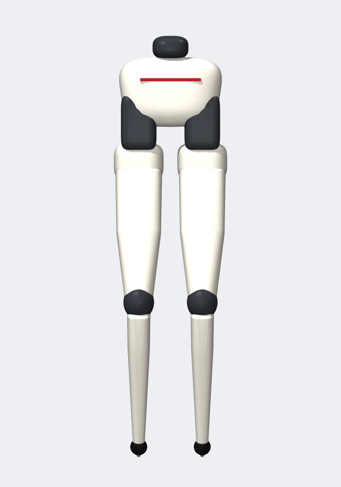</td>
</tr>
</table>
<sub>Concept art: Aigis, official artwork from <i>Persona 3</i> (© ATLUS), via the
<a href="https://hero.fandom.com/wiki/Aigis">Aigis wiki page</a>. Not my work; shown as design
reference for a non-commercial project and will be removed on request.</sub>
<br><br>

**The question:** can a hobby-scale biped with narrow hips, slender tubular legs, **no ankle and
no foot** learn to balance and walk, using parts anyone can buy? If not, what is the smallest
change to the silhouette that makes it work?

Why it is hard:
- **No support polygon.** A ball-tipped leg touches the floor at a single point. Two point
  contacts give no area to keep the centre of mass over, so the robot can tip about the line
  between them.
- **Weak, slow actuators.** Hobby servos are slow and torque-limited. A policy that only works with
  ideal actuators would be meaningless here.

## 2. Design (before any training)

### 2.1 Size and proportions

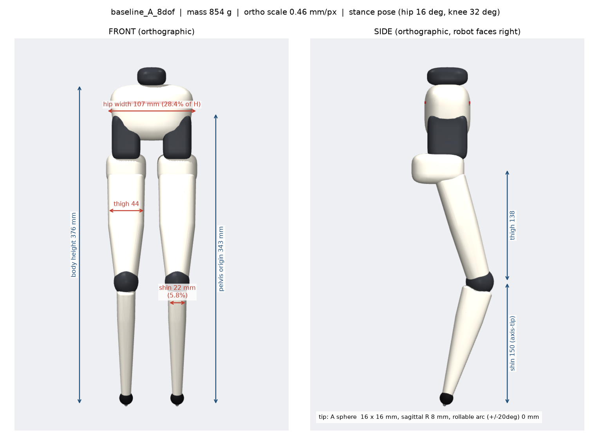

- **Scale:** I wanted a narrow pelvis and long, slim legs to get the slender, graceful form factor,
  at a hobby scale where cheap servos are credible: pelvis about 0.30–0.35 m off the ground and a
  0.6–1.0 kg lower body. The result is 38 cm tall and 0.85 kg.
- **Leg lengths:** thigh 138 mm, shin 150 mm (a long shin for the slender look).
- **Slimness targets:** hip width ≤ 24–28 % of height and shin width ≤ 9–12 %.
  - The shin reached **5.8 %**.
  - The hips reached **28.4 %**, just over the target: the 25 mm-thick servo cases set the floor.
- **Parametric generator:** the whole body comes from [`configs/geometry.yaml`](configs/geometry.yaml)
  as superellipse shells. Every part carries its real mass and inertia (servos, printed shells,
  brackets, electronics, battery), so the simulated centre of mass matches the CAD estimate.

### 2.2 Choosing off-the-shelf actuators

| candidate | stall torque | no-load speed | price | verdict |
|---|---|---|---|---|
| Feetech STS3215-C018 (12 V) | 2.94 N·m | 4.7 rad/s (45 rpm) | $32 | ✗ the knee can't swing faster than ~1 step/s |
| **Feetech STS3215-C046 (7.4 V)** | 1.41 N·m | 11.1 rad/s (106 rpm) | $25 | ✓ **roll, pitch and knee**, same 45 × 25 × 35 mm case |
| **Feetech STS3032 (6 V)** | 0.44 N·m | 11.6 rad/s | $15 | ✓ **hip yaw** (low load, small case) |
| ROBOTIS XC330 / XL330 | 0.92 / 0.52 N·m | 6.8 / 10.8 rad/s | $103 / $24 | slimmer hips, but speed-limited and ~3.4× the cost |

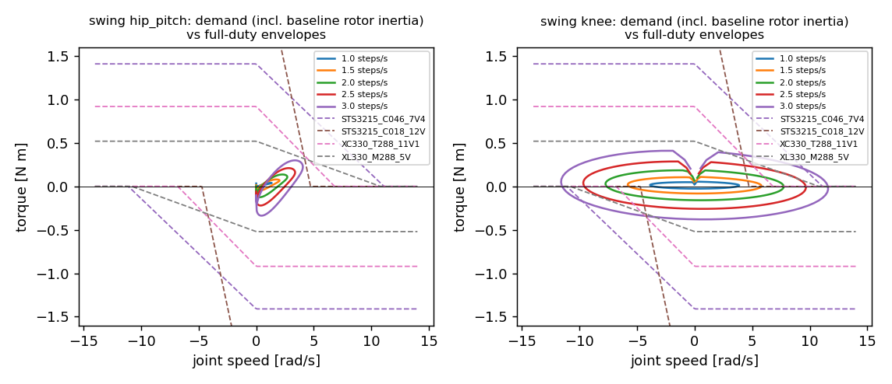

The torque-speed audit above (`scripts/torque_audit.py`) runs before any learning. It overlays
the torque and speed that leg swing demands at 1–3 steps/s on each servo's DC-motor envelope:
- **Speed binds, not torque.** The 12 V servo has twice the torque, but its envelope collapses
  above ~4.7 rad/s, so it was rejected without spending any GPU time.
- **Choice:** the 7.4 V variant in the same case. Eight servos cost about **$180**.
- **Servo model:** every servo is simulated with its torque-speed curve, current limit, 4 ms bus
  latency, deadband, slew limit and reflected rotor inertia.

### 2.3 Servo placement and motion

<table>
<tr>
<td>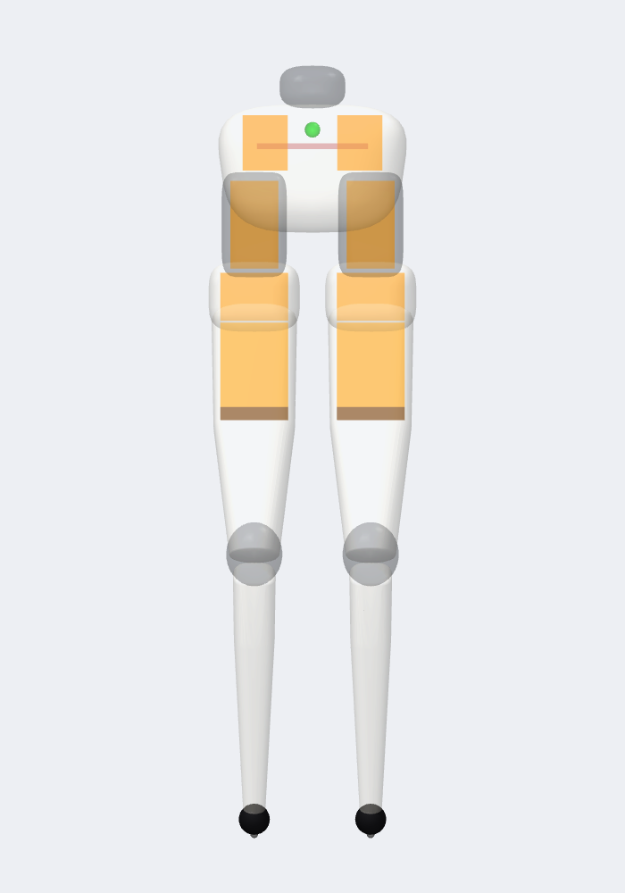</td>
<td>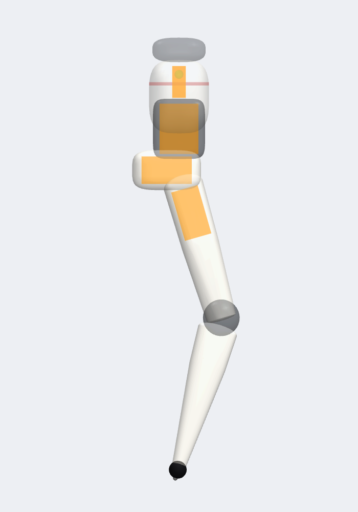</td>
</tr>
</table>


- **Four servos per leg.** Hip yaw, roll and pitch sit stacked at the pelvis with their axes meeting
  near one point, so together they act like a ball joint. The knee is a single hinge.
- **Remote knee drive.** The knee servo lives in the upper thigh and drives the knee through a 1:1
  GT2 belt. That keeps the knee joint as slim as the concept art.
- **Packaging check.** It verifies that every servo case fits inside its printed shell with a
  1.2 mm wall.

### 2.4 Design candidates and pre-training screening

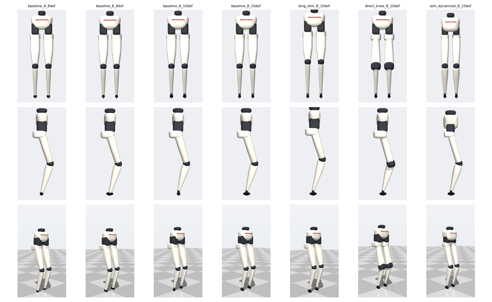

Seven variants were generated and screened with three cheap checks before training:

| gate | what it checks | outcome |
|---|---|---|
| A: packaging & silhouette | servo cases inside shells, slimness ratios | `direct_knee` and `slim_dynamixel` flagged |
| B: torque/speed audit | static and swing demand vs servo envelopes | 12 V servo rejected; slim Dynamixel speed-limited |
| C: passive sanity | hold the standing pose with no balance policy | every variant falls within 0.7–1.1 s |

Two tip shapes went forward, a 16 mm ball (**A**) and a 32 × 13 mm elongated rocker (**B**), at
8 DoF. The 10-DoF ankle variant was dropped: an ankle can't shift the centre of pressure on a
point contact, so it adds mass for nothing. **Baseline A (ball tip, 8 DoF)** became the preferred
design.

## 3. Training

### 3.1 Pipeline

- **Simulation:**
  - MuJoCo 3.17 with **MJX on the GPU** for training: 4,096 parallel robots, 2 ms physics,
    50 Hz control.
  - An **independent CPU MuJoCo evaluator** for testing: full contact set, more accurate solver,
    and a NumPy re-implementation of the policy (identical to training inference).
- **Learning:** PPO (Brax) with an asymmetric actor-critic.
  - The **actor** sees only what the real robot can sense: IMU gravity and gyro, joint
    positions and velocities, last action, command and gait clock.
  - The **critic** also sees privileged state.
  - **Domain randomization:** friction, masses, CoM, rotor inertia, gear friction, servo
    strength, speed and gain, latency, and backlash.
- **Evaluation:**
  - **Acceptance gates:** stand 30 s, walk ≥ 2 m, walk → stop → walk, and servo load within
    ratings, each tested on **100 held-out seeds**.
  - **Checkpoint selection:** a rule declared in advance (highest in-training eval reward), never
    hand-picked from test results.
  - **Behaviour metrics:** lift-offs, foot sliding, step length, airborne vs sliding foot travel.

### 3.2 Iterating on the policies: challenges and fixes

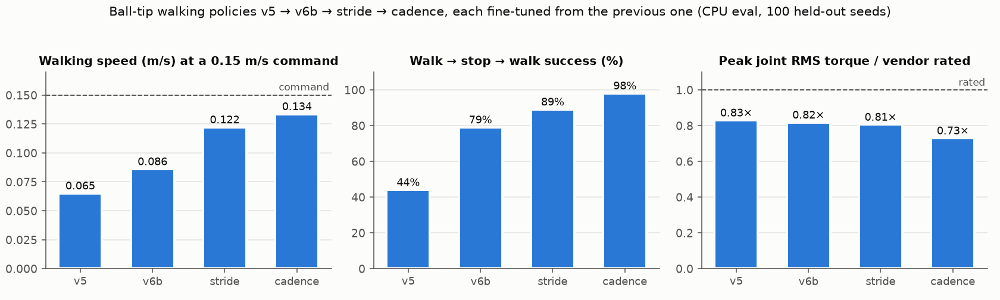

| problem I hit | diagnosis | fix |
|---|---|---|
| **Standing:** a quiet-stand reward taught the robot to *fall slowly* | with point feet, stepping is required; the reward fought the physics | reward stepping in place (v1) |
| **Standing:** v1 ran hip roll at 1.29 × rated torque | the simulator clipped torque, but nothing discouraged sustained load | sustained-torque, saturation and over-speed penalties (v2): ≤ 0.88 × rated, survival *up* 96 → 99 % |
| **Walking:** v2 stepped in place forever | reward exploit: alive + gait rewards paid more than tracking | stronger, wider velocity tracking (v3) |
| **Walking:** v3 walked but drifted 80° off course | yaw-rate tracking had no gradient through the micro-stepping jitter | heading command plus a direct heading-hold reward (v5) |
| **Walking:** v5 couldn't stop | a 0.09 m/s creep barely lost any tracking reward | sharp zero-command stop reward (v6) |
| **Walking:** v6 collapsed within 10 M steps | warm start re-initialized the **critic** at full learning rate | restore the critic, lr 1e-4 (v6b) |
| **Walking:** long runs regressed after their peak | forgetting and reward exploitation | declared checkpoint rule; short low-lr fine-tunes |
| **Walking:** speed only 57 % of command | — | stride and cadence fine-tunes: **0.134 m/s, 98 % start/stop, 0.73 × rated** |

Things I tried that **did not** work:
- **Domain-randomization fine-tune:** no robustness gain.
- **Push-recovery training:** pushes still break it.
- **Ball-tip stillness:**
  - quiet-stand fine-tunes and lift-off penalties never stopped the stepping;
  - nor did **ideal 100 Hz, zero-latency control**.
- **Strides:**
  - stride rewards from scratch: the ball falls within 3 s;
  - a hard cadence clock: the policy ignored it.
- **20 mm pad:** too small to stand still.

### 3.3 Training curves

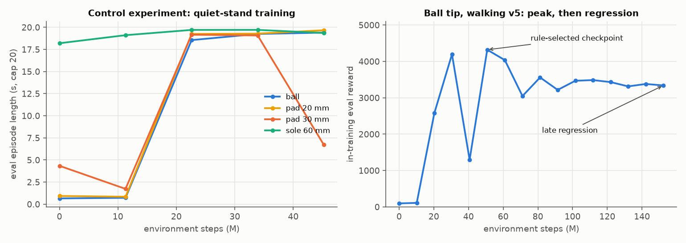

- **Left:** in the control experiment, flat soles start out standing (their untrained policy
  already survives about 18 s). The ball and the small pads must first learn to step. The 30 mm
  pad run collapsed after its peak, and the declared rule picked the peak.
- **Right:** a typical walking run peaks and then regresses. This is why checkpoints are selected
  by a rule declared in advance.

### 3.4 Control experiments: is footlessness really the problem?

The ball robot never stood still. To find out whether that was the missing feet or something else
(reward, servos, control rate), I built **separate control frames**: the same legs, servos and
training recipe, but a different ground contact. Baseline A was not modified.

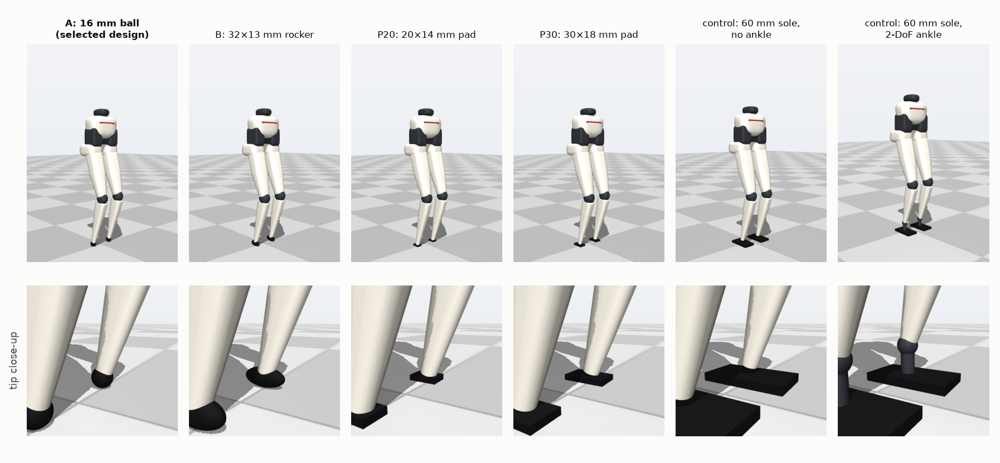

**Passive test, no policy** (servos hold the standing pose, clean start, 10 s):

| contact | survives |
|---|---|
| ball 16 mm | falls in **0.76 s** |
| flat pad 20 mm, pad 30 mm | **10 s** |
| flat soles 40–90 mm, with or without ankle | **10 s** |

Any flat contact has a static equilibrium; a ball has none.

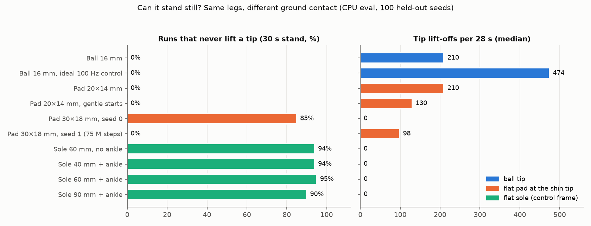

Findings:

| contact type | stand still? | walk |
|---|---|---|
| **round ball** (16 mm) | never: ~6 steps/s, 210 lift-offs per run | dynamic, ~1.8 cm steps |
| **elongated rocker** (32 × 13 mm, round 1) | never: 7.6 steps/s | same as the ball (92 % vs 85 % reach 2 m) |
| **flat pad at the shin tip**, 20 mm | no: 5.3 steps/s | — |
| **flat pad at the shin tip**, 30 mm | **yes, 85 % no-lift** (1 of 2 seeds) | **3.6 cm steps**, 2× the ball |
| **flat soles** 40 / 60 / 90 mm with ankle | **yes, 94 / 95 / 90 %**; bigger soles slide less | skated or marched in place |
| **flat sole 60 mm without ankle** | **yes, 94 %**, the same as with an ankle | — |

What this shows:
1. **Point contacts force stepping.** Same reward, same legs: every flat contact large enough
   stops the stepping; the ball never does. Two point contacts leave a tip-over direction that no
   joint can resist.
2. **The ankle doesn't matter for standing.** A rigid sole stood as well as one on a 2-DoF ankle.
   The hip and knee can tilt a rigid flat contact well enough.
3. **Size threshold.** For this 0.86 kg robot, the threshold lies between a 20 mm pad (no) and a
   30 mm pad (yes).
4. **Feet do not fix short steps.** Under the ball's walking reward the footed robot *skated* its
   soles forward. Under a stride reward it *marched in place*. Short steps come from reward design
   and training, not the contact alone. Even so, the 30 mm pad doubled step length over the ball
   at an identical reward and initialization.

## 4. Results

### Ball tip (the original concept): balances and walks, but only dynamically

<table>
<tr><th>Stand (zero command): micro-steps</th><th>Walk (0.15 m/s command, heading hold)</th></tr>
<tr>
<td></td>
<td></td>
</tr>
<tr><th colspan="2">Walk → stop → walk</th></tr>
<tr><td colspan="2" align="center"></td></tr>
</table>

| gate (100 held-out seeds) | target | result (`cadence_A8_ft`) |
|---|---|---|
| free stand 30 s | ≥ 70 % | **100 %** |
| walk ≥ 2 m without falling | ≥ 70 % | **100 %** (40 s test, median 5.3 m, 1.5° heading drift) |
| walk → stop → walk | ≥ 50 % | **98 %** (0.14 → 0.01 → 0.14 m/s) |
| servo load | within ratings | RMS **0.46–0.73 × vendor rated**; peak joint speed 0.79 × no-load; 0 over-speed events |
| **stand still** | — | **never**: micro-steps ~6 times/s |

The ball-tip leg *can* balance and walk with cheap servos, which answers the original question.
But it can never stand still. A robot that must constantly step to stay up is not good enough for
the robot I want to build.

### 30 × 18 mm flat pad: a viable compromise

<table>
<tr><th>Stands without stepping</th><th>Walks (2× longer steps than the ball)</th></tr>
<tr>
<td></td>
<td></td>
</tr>
</table>

- **Same robot otherwise:** same 8 servos, no ankle, no foot. The pad is rigid at the shin tip, and
  the hip and knee servos keep it flat.
- **Standing:** 94 % survive 30 s, and **85 % never lift a tip**. Body motion is about 2 cm in
  30 s, in a split stance with one pad ahead of the other.
- **Walking:** 100 % reach 2 m. It reaches the full commanded speed (0.157 m/s) in **3.6 cm steps
  at 4.25 steps/s**; the ball takes 1.8 cm steps at 7 steps/s.
- **Caveats:**
  - Quiet stance was found on 1 of 2 training seeds; the second was still slowing its stepping
    after 75 M steps.
  - Standing and walking are separate policies, and the walking policy stops poorly (44 %).

### Footed control frames: why feet alone are not the answer

<table>
<tr><th>60 mm soles: stands still</th><th>Same robot "walking": skates its soles</th></tr>
<tr>
<td>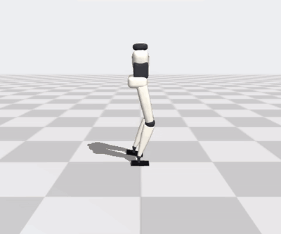</td>
<td>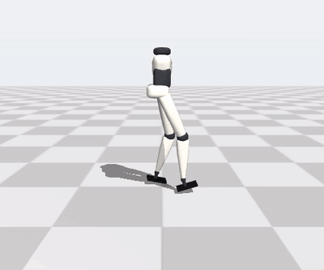</td>
</tr>
</table>

### Verdict

| | ball tip | **30 mm pad** | flat feet (control) |
|---|---|---|---|
| silhouette | ✓ concept-faithful | ✓ almost unchanged | ✗ |
| balance and walk | ✓ dynamic | ✓ | ✓ stands; walking degenerate |
| stand still | ✗ never | **✓ 85 %** (1 of 2 seeds) | ✓ 90–95 % |
| step length | 1.8 cm | **3.6 cm** | skates / marches |

**The 30 mm flat pad gives up a little of the concept's needle-point look for quiet standing, and
is the design to take forward.**

## Engineering practices

- **Pre-training gates:** packaging, torque/speed and passive checks killed bad designs before any
  GPU time was spent.
- **Independent evaluation:**
  - a separate CPU simulator with the full contact model and policy re-implementation;
  - 100 held-out seeds;
  - a declared checkpoint rule, amended once and openly.
- **Honest reporting:** every run is logged in [`docs/experiments.md`](docs/experiments.md) (E0–E39,
  about 15 GPU-hours), including failures, collapses, a post-hoc pick I caught and relabelled, and a
  seed that did not reproduce.
- **Unattended GPU safety:** a one-job-at-a-time queue with a stall watchdog and a 30-minute
  health check (`scripts/queue_runner.sh`, `scripts/health_watch.sh`).
- **Tests:** 36 tests for model integrity, actuator limits, contacts and reproducibility.

## Reproduce

```bash
uv venv -p 3.12 .venv && uv pip install --python .venv/bin/python -r requirements.txt
.venv/bin/python models/generate_model.py && .venv/bin/python scripts/regen_train_models.py
.venv/bin/python -m pytest -q tests

# evaluate the included policies on CPU (100 held-out seeds)
.venv/bin/python scripts/evaluate.py cadence_A8_ft --test walk40 --params params_0020M.pkl
.venv/bin/python scripts/evaluate.py q2_stand_P30 --test stand --params params_0022M.pkl
.venv/bin/python scripts/gait_anatomy.py stride_P30_ft --params params_0020M.pkl
.venv/bin/python scripts/make_readme_figures.py   # regenerates the charts above

# train on a GPU (one job at a time)
scripts/gpu_python.sh scripts/train.py --name my_walk --model baseline_A_8dof --task walk --steps 150e6 --dr
```

## Repository map

| path | contents |
|---|---|
| `configs/` | parametric morphology including the control frames (`geometry.yaml`); servo catalogue with sources (`actuators.yaml`) |
| `models/generate_model.py` | MJCF generator: exterior shells, servo envelopes, collision primitives, training and evaluation contact sets; `models/ref/` reference-gait tables |
| `slender_biped/` | servo model, MJX training env, CPU evaluator, reference gait (`ref_gait.py`), morphology tools, renderer |
| `scripts/` | training, evaluation, gait anatomy and gait quality, walker/stander hand-over, audits, renders, figures, GPU queue and watchdogs |
| `runs/` | config and learning curve of every run; weights of the selected policies |
| `results/` | evaluation JSONs behind every number; plots |
| `docs/` | [spec](docs/project_spec.md) · [morphology](docs/morphology.md) · [actuator research](docs/actuator_research.md) · [feasibility](docs/actuator_feasibility.md) · [experiment log](docs/experiments.md) · [sim-to-real risks](docs/sim2real_risks.md) |

## 5. Toward hardware: the P0 printable leg

<br>
<sub>The assembled P0 left leg, printed in PLA: pelvis fixture and hip yaw (right), hip roll and pitch, thigh, knee and shin with the pad (left).</sub>


The next step is a real leg. [`hardware/leg_p0/`](hardware/leg_p0/) contains a parametric,
print-ready CAD of one 4-DoF leg on a desk-clamped pelvis fixture:
- **Build123d source:** regenerate with one command.
- **Exports:** STL, 3MF and STEP for every part, plus mirrored right-leg parts and print-oriented copies.
- **Servos:** Feetech STS3215s with a **direct-drive knee** (no belt): C001 (1:345) at the hips and a
  faster C044 (1:191) at the knee.
- **Pad:** the 30 × 18 mm flat pad from the control experiments.

The CAD is checked automatically before printing: interference and range-of-motion sweeps include
servo dummies, screw heads and connector keep-outs. Calibration coupons, a BOM, a beginner assembly
guide and a bench tool ([`software/feetech_bench.py`](hardware/leg_p0/software/feetech_bench.py)) are
included.

### 5.1 From a first print that didn't fit to a full leg

**The first test print didn't fit.** The yaw bracket was built from the servo's datasheet drawing, and:
- **Screws:** the horn screw holes were sized for M2, but the STS3215 horns take M3, so no screw went in.
- **Pocket:** the case pocket was the wrong shape. The recess for the bump around the idler horn was too
  narrow and jammed the servo.
- **Counterbores:** one bracket arm was counterbored all the way through, which left the screw heads
  nothing to bear on.

**The fix was to borrow from an arm that already works.** The open-source
[SO-101 / SO-ARM100](https://github.com/TheRobotStudio/SO-ARM100) robot arm uses the same STS3215 servo.
Its follower-arm STEP files give the real case geometry, and its build guide gives the screw sizes.
- **Pocket:** I measured the case-bump widths from that STEP (horn side 7.0 mm, idler side 9.1 mm
  half-width) and checked every joint against the real servo shape: zero overlap in all four.
- **Screws:** M3×6 horn screws through 3.4 mm holes, and M2×6 self-tappers into the case, as on the
  SO-101. Each counterbore leaves 2 mm of wall under the head.

After that one correction, every part printed afterwards (P03–P07, the pad and the P08 pelvis) fit the
servos and screws first time, and the full leg went together without rework. The only other print change
was a solid shin: the hollow version let the pad socket break into the cavity.

### 5.2 Bench tests

Each servo was zeroed with the leg square, given its direction, and then swept on its own and with its
neighbours. After that, the whole leg ran keyframe routines. In the clips below, the hand only steadies the
pelvis fixture.

<p>


</p>

- **Sit-up (left):** the leg stands on its pad, squats and rises under its own power, without being lifted.
- **Kick (middle):** hip pitch and knee swing the shin through a kick.
- **Hip yaw (right, the `look` routine):** turns the leg to both yaw limits while it stands on the pad.

**The leg is ready to bear load.** P0 was designed for unloaded bench motion, with weak brackets as a flagged
risk. In practice the PLA parts are strong enough to stand on: in the sit-up the leg carries the hip and
pelvis fixture on its pad and pushes back up to standing by itself, with no visible flex at the brackets
and no slipping at the horns. That is on a 5 V bench supply, where the servos are slower and weaker than at their
rated 7.4 V.

**Status:**
- **Left leg:** printed in PLA, assembled, calibrated (all four joints) and load-tested.
- **P08 pelvis:** a one-piece two-leg pelvis with 80 mm hips, designed and print-ready.
- **Right leg:** the mirrored part set, print-ready.

## 6. Training on the as-built model

<table>
<tr><th>Stand, with 0.3 m/s shoves</th><th>Walk (0.15 m/s command)</th></tr>
<tr>
<td></td>
<td>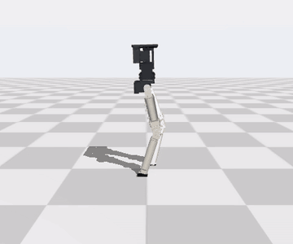</td>
</tr>
</table>

The earlier rounds trained on a parametric model. Once the CAD existed,
[`cad/sim_model.py`](hardware/leg_p0/cad/sim_model.py) generated a MuJoCo model of the robot **as it will be
built**:
- **links:** mass, centre of mass and inertia from the actual printed parts (walls and infill), servo cases,
  horns, screws and cables;
- **kinematics:** joint axes, link lengths and joint limits from the CAD;
- **contact:** the real 30 × 18 mm pad;
- **servos:** the ones actually bought, C001 (1:345) on the hips and C044 (1:191) on the knee;
- **pelvis:** P08, hips 80 mm apart.

The result weighs 907 g. Its weak point is the hip servos: they are half as fast as the servo the earlier
rounds assumed, and their 1:345 gearbox roughly doubles the effective inertia the hip has to swing.

| as-built model, 100 held-out seeds | result |
|---|---|
| stand 30 s (`hw_stand_push2`) | 98 % up, 98 % without lifting a pad; survives 20 s of 0.3 m/s shoves |
| walk at a 0.15 m/s command (`hw_walk_scratch_stride2`) | 98 % reach 2 m, **0.178 m/s**, stops and restarts on command 98 % of the time |
| same walker, push-trained (`hw_walk_best_push`) | 87 % keep walking under 0.2 m/s shoves |
| supply current at 7.4 V | quiet stand 0.4–0.7 A; walking ~1.5 A mean, ~9 A peaks over 20 ms ([power and wiring](hardware/leg_p0/power.md)) |

What the 23 runs showed ([experiment log](docs/experiments.md), E40–E45):
- **Training mattered more than hardware.** Transferring the earlier walker capped the as-built robot at
  about 0.09 m/s. A gait learned from scratch on the new model, then refined, reached 0.178 m/s on the
  same servos. That walker was found on 1 of 2 training seeds.
- **Cheap changes didn't help.** A fully charged 8.4 V pack, 40 mm pads and 60–70 mm hips stayed within
  the seed-to-seed spread.
- **The one reliable hardware gain needs two changes together:** faster C046 servos on roll/pitch/knee
  *and* 60 mm hips (0.15–0.17 m/s on 3 of 3 seeds). Either alone did nothing: narrower hips only pay off
  once the hips are fast enough.

## 7. Walking with real steps (round 4)

<table>
<tr><th>Before: the round-3 walker</th><th>After: side</th><th>After: facing (catwalk line)</th></tr>
<tr>
<td></td>
<td></td>
<td>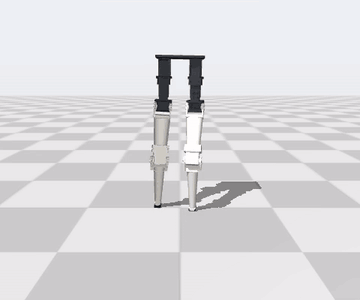</td>
</tr>
</table>

The round-3 walker reached 0.178 m/s, but it **skittered**: 5–7 tiny hops a second, 60 ms in the air, 2 cm per
step and ~5 mm of foot clearance. Reward shaping alone kept finding that gait. Round 4 (11 GPU-hours, 28 runs,
[E46–E56](docs/experiments.md)) gives the policy a *reference gait* to imitate instead:
[`ref_gait.py`](slender_biped/ref_gait.py) computes a walking pattern for the as-built leg by inverse kinematics on
the CAD model, and the policy outputs corrections around it.

| at a 0.15 m/s command, as-built model | round-3 best (skitter) | **round 4, catwalk** (`r4k_cat2_ft`) |
|---|---|---|
| foot travel per step | 2.4 cm | **6.2 cm** |
| time in the air per step | 60 ms | **160 ms** |
| swing clearance | 5 mm | **19 mm** |
| share of foot travel spent sliding | 22 % | **9 %** |
| step width (feet side to side) | 189 mm | **72 mm** (inside the 80 mm hips) |
| reach 2 m in 40 s / speed | 98 % / 0.178 m/s | **100 % / 0.162 m/s** |
| supply current, mean | 1.5 A | 2.2 A |
| hip servos, RMS torque / rated | 0.83 | **1.0** |

What made it work, and what didn't:
- **Imitation gives real steps; it does not move an existing gait.** From scratch, the reference produced
  real 200 ms swings within 20 M steps. Fine-tuning the skitter with the same rewards kept the skitter.
- **The "marching in place" was walking in circles.** The first imitation walkers moved forward at
  0.09 m/s but turned 3–4° a second, so they went nowhere. With 80 % of the time on one small, edge-loaded
  pad, a footless leg has almost no grip in yaw. Stronger heading rewards and freeing the hip-yaw joints
  didn't help; **more double support did** (both pads down ~30 % of the cycle), and so did a faster
  3.6–4.2 steps/s reference.
- **A modelling fix:** the pad's twisting friction was defined in the CAD-derived model but switched off by a
  contact setting. Turning it on halved stop failures and cut hip overspeed 10× for the same recipe; the
  round-3 walker is unaffected.
- **Elegance by curriculum.** A narrow track can't be learned from scratch. Narrowing the reference in stages,
  then penalizing wide feet, took the stance from 116 mm (the skitter: 189 mm) to 72 mm, with a slight pelvis
  twist and a higher swing.
- **Standing:** no walker learned to stand still at zero command. Handing over to the round-3 standing
  policy does: walk → stop → walk succeeds 85–88 % of the time with 0–5 % falls
  ([`switch_eval.py`](scripts/switch_eval.py)).
- **Didn't help:** sharper tracking or slip penalties from scratch (no learning), push training (more robust,
  but the gait reverted to a skitter), stronger torque penalties and 60 mm hips (the hip servos stay at
  their rated torque). **Real steps on the C001 hip servos mean warm hips**; see
  [power and wiring](hardware/leg_p0/power.md).

## Limitations and next steps

- **Simulation only.**
  - Feetech specs come from retailer listings; rotor inertia, gear friction and thermal behaviour
    are estimates.
  - Real rubber pads, floor compliance and belt backlash will differ from MuJoCo's soft contacts.
- **Seeds.** Most results come from one training seed per configuration. The pad's quiet stance
  reproduced on 1 of 2; the round-4 walking and catwalk results on 2 of 2.
- **Robustness.** Large pushes (0.5 m/s) and slippery floors (μ ≤ 0.35) still break walking.
  Turning works only through an outer heading loop.
- **Next steps:**
  1. merge standing and walking into one policy (today: a hand-over between two);
  2. walking under pushes without losing the stepping gait (push training reverted it to a skitter);
  3. hip load: the imitation gait runs the C001 hip servos at rated torque; faster hip servos (C046) or
     shorter walking bouts with temperature monitoring;
  4. bench-test servo torque-speed curves, pad friction (including twisting friction) and IMU noise;
  5. print P08 and the right leg, then measure on the real robot (knee torque, servo current, joint speeds
     under load) and refit the as-built model before trying a trained policy on it.
