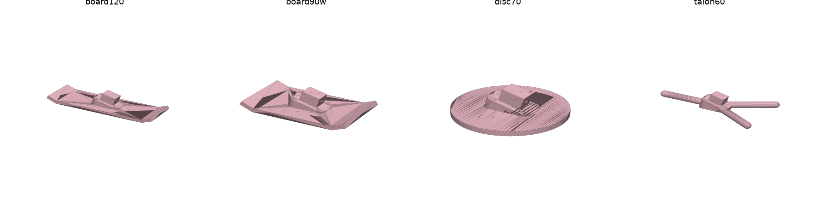

# Bigger feet for soft floors (round 2026-11-08)

Goal: the robot stands, and catches itself after being set down by hand, on soft rugs. Only the foot pads may change;
body and servos stay as built. Policies are judged in simulation first, and must be very reliable there to have a
chance on the robot.

## 1. Simulator additions for this round

| what | before | now |
|---|---|---|
| **Torso and head** | the robot has been tested with them off (legs + pelvis, 0.91 kg; `docs/sim_to_real.md`), and the models match that | two model sets per pad: **legs-only** (`hw_pad_<d>_legs_8dof`, as tested so far) and **full body** (`hw_pad_<d>_8dof`): torso (213 g, `torso_p0/torso_report.json`) and H1 head (140 g nominal; 160 g solid in `head_p0/head_report.json`) on the pelvis, **1.26 kg, centre of mass 0.35 m up instead of 0.27 m**. Per-body mass randomization (±15 %) covers the head's uncertainty |
| **Soft floors** | rigid floor (training on hard and mat-like floors only) | rug model: soft contact whose time constant sets the sinkage. The original pad sinks ~3 mm (`rug1`), ~9 mm (`rug2`) and more (`rug3`). Sinkage scales with the pad's area, as for a real rug (pressure, not force, sets how far fur compresses): the time constant is scaled by sqrt(31×18 mm² / pad area) |
| **IMU** | policy saw the true gravity direction (+ 1.7° white noise) | optional emulation of the RP2040 firmware's complementary filter (`imu_filter`): gravity estimate propagated by the gyro and pulled toward the accelerometer, which also feels the pelvis accelerating. With the original firmware settings it gives 3.9° RMS tilt error (95 %: 7.8°) on a wobbling robot; the robot logs showed 4–6° RMS (95 %: 8–11°) |

Sections 3–5 were run on the full-body models (the torso and head will go back on, and the heavier, taller robot is
the harder case); section 5 adds the legs-only results for the robot as it is tested now.

Firmware change that goes with the IMU model (`hardware/imu/imu_stream.py`): gyro range ±250 → ±1000 °/s (the robot's
pelvis twists at up to ~300 °/s and the gyro saturated in 28 of 30 runs), and the accelerometer is only used while it
reads within 0.15 g of 1 g. In the simulator this cuts the tilt error from 3.9° to 2.9° RMS.

## 2. Pad designs

`scripts/make_pads.py` builds each design as MuJoCo primitives under the shin tip, with its sole in the original
pad's sole plane (level at the stance pose, same standing height), its mass added to the shin, and left/right pad
collisions (cheap capsule/sphere stand-ins: box-box pad pairs cost MJX ~30 % of its speed and slowed training ~3×).
`hardware/feet_p1/cad/pads.py` builds the same shapes as printable parts: the original P07 stem and wedge with the
new sole fused under it, so they plug into the unchanged shins.

| design | sole | area | added mass |
|---|---|---|---|
| `orig` | 31 × 18 mm box | 5.6 cm² | — |
| `board60/90/120` | snowboard 60 / 90 / 120 × 36 mm, last 12 mm at each end bent up 25° | 13 / 24 / 35 cm² | 4–11 g |
| `board90w` | snowboard 90 × 50 mm | 33 cm² | 11 g |
| `disc50/70` | flat round pad | 20 / 38 cm² | 4–9 g |
| `dome50/70` | domed round pad (6 mm tall) | — | 4–9 g |
| `claw45/60` | three claws (8 mm thick) at 0 / ±120° from an 18 mm hub | 12 / 16 cm² | 2–5 g |
| `talon45/60` | bird foot: two toes forward at ±30°, one back | 12 / 16 cm² | 2–5 g |

## 3. Passive screen: what the pads give with no balance control

`scripts/pad_passive.py`: the robot holds its stance pose (servos on, no policy) and is set down tilted in 8
directions; fraction still standing after 4 s.

| design | hard 3° | hard 6° | rug1 3° | rug1 6° | rug2 3° | rug2 6° | rug3 3° | rug3 6° | rug3 10° |
|---|---|---|---|---|---|---|---|---|---|
| `orig` | 38 % | 0 % | 0 % | 0 % | 0 % | 0 % | 0 % | 0 % | 0 % |
| `board60` | 38 % | 0 % | 0 % | 0 % | 0 % | 0 % | 0 % | 0 % | 0 % |
| `board90` | 100 % | 25 % | 100 % | 75 % | 100 % | 75 % | 0 % | 0 % | 0 % |
| **`board120`** | 100 % | 100 % | 100 % | 100 % | 100 % | 100 % | 75 % | 100 % | 25 % |
| `board90w` | 100 % | 62 % | 100 % | 62 % | 100 % | 88 % | 100 % | 62 % | 0 % |
| `disc70` | 75 % | 12 % | 100 % | 38 % | 12 % | 25 % | 0 % | 0 % | 0 % |
| `dome50/70` | 0 % | 0 % | 0 % | 0 % | 0 % | 0 % | 0 % | 0 % | 0 % |
| `claw60` | 100 % | 75 % | 100 % | 88 % | 0 % | 0 % | 0 % | 0 % | 0 % |
| `talon60` | 100 % | 75 % | 100 % | 100 % | 0 % | 0 % | 0 % | 0 % | 0 % |

* With the original pads the robot cannot stand on a rug at all without active balance, even set down perfectly:
  this matches what happened on the real rugs.
* Fore-aft is the weak direction (31 mm pad, centre of mass 0.35 m up: 2.5° of lean puts it past the toe), so length
  matters most. 120 mm boards are passively stable to ~8° on every rug; 90 mm boards to ~4–6°.
* Claws and talons work on firm floors but sink in on soft rugs (little area), and domes roll.

## 4. Trained policies

Screening: one run per design, 40 M steps from `hw_recover_soft`, on the full 1.26 kg robot, mostly rug-soft floors
(time constant 0.02–0.3 log-uniform, scaled by pad area; damping ratio 0.7–2; friction 0.4–1.2), half the episodes
starting like a hand placement (3–9° tilt, already tipping at 0.3 rad/s std per axis), shoves 0.12 m/s, the fitted
5 V servo model with its randomization. `scripts/pad_queue.sh` has the exact command; ~36 min per design.

Test (`scripts/place_eval.py --rugs`): set down tilted by 3 / 5 / 7 / 9° in a random direction and already tipping
(0.3 rad/s std per axis, so up to ~40 °/s), policy at full strength from the first step; fraction standing after 8 s.

**First pass, 16 starts per cell, true gravity as the IMU input:**

| design | rug | 3° | 5° | 7° | 9° |
|---|---|---|---|---|---|
| `board120` (120 × 36) | firm / medium / deep | 100 / 100 / 94 % | 88 / 94 / 81 % | 81 / 88 / 69 % | 75 / 75 / 62 % |
| `board90w` (90 × 50) | firm / medium / deep | 94 / 100 / 94 % | 94 / 94 / 88 % | 81 / 81 / 81 % | 81 / 81 / 81 % |
| `board120w` (120 × 50) | firm / medium / deep | 100 / 100 / 100 % | 94 / 100 / 100 % | 88 / 81 / 81 % | 81 / 81 / 81 % |
| `board150` (150 × 40) | firm / medium / deep | 100 / 100 / 100 % | 100 / 94 / 94 % | 88 / 88 / 75 % | 81 / 75 / 75 % |
| `talon60` | firm / medium / deep | 100 / 62 / 12 % | 88 / 62 / 6 % | 75 / 38 / 6 % | 62 / 44 / 12 % |

**Final comparison, 40 starts per cell, the robot's IMU filter (new firmware settings) as the input, medium rug**
(the firm and deep rugs are within a few points of these):

| | 3° | 5° | 7° | 9° |
|---|---|---|---|---|
| `pad_board120w` | 95 % | 95 % | 85 % | 78 % |
| `pad_board120w`, no policy (servos hold the stance) | 88 % | 82 % | 70 % | 65 % |
| `rug_board120w` (100 M more, trained with the IMU filter) | 95 % | 88 % | 72 % | 72 % |
| `rug_board120w_long` (60 M more, without it) | 95 % | 92 % | 82 % | 78 % |
| **`pad_board150w`** (150 × 50) | 95 % | 90 % | 80 % | 75 % |
| `pad_board150w`, no policy | 95 % | 92 % | 80 % | 70 % |

Quiet standing on rugs (6 starts per rug, 15 s, IMU filter on): `pad_board150w` 18/18 standing, 0.4° of sway, body
rates 1–3 °/s; `pad_board120w` 17/18, 0.7–0.8°, up to 16 °/s of yaw. The robot with the old pads and policy: ~6°
of sway and up to 150 °/s of yaw.

What this says:

* **Big boards win; claws and talons sink.** The eagle-claw idea works on a firm rug but its thin toes sink into fur.
* **Width matters on deep rugs, length everywhere.** `board90w` beat the longer, narrower `board120` on deep fur.
* **The pad does most of the work.** With no policy at all, `board150w` catches as many placements as either policy;
  `board120w` needs its policy for the last ~10–15 points. The 3–5 % lost even at 3° are the starts drawn tipping
  fastest (up to ~40 °/s): they fail with and without a policy, so they are past what a standing robot can catch
  without stepping.
* **More training didn't help.** 60 M or 100 M more steps (with or without the IMU filter) did not beat the 40 M
  screening policies: the policy is at what the pad allows.
* **Training with the IMU filter didn't help either** (it made the placement catches worse, though it stood more
  quietly on firm rugs). With big pads the screening policies lose only a few points when the IMU filter is switched
  on in the test, so the IMU error matters much less than it did on 31 mm pads.

## 5. Recommendation

Print **`F_board150w`** (150 × 50 mm, `hardware/feet_p1/exports/`).

**Legs only (the robot as tested so far): `pad_board150w_legs`.** 40 M steps from `pad_board150w` on the legs-only
model. Placement test with the IMU filter on, 40 starts per cell:

| `pad_board150w_legs` | 3° | 5° | 7° | 9° |
|---|---|---|---|---|
| firm rug | 100 % | 100 % | 100 % | 98 % |
| medium rug | 100 % | 100 % | 100 % | 95 % |
| deep rug | 100 % | 100 % | 100 % | 98 % |

Quiet standing: 18/18, 0.2° of sway, body rates 0–3 °/s. Passively (stance held, no policy) the legs-only robot
on these boards rights itself from 10° in every direction on every rug; with the original pads it falls on every rug
from any tilt.

**With torso and head: `pad_board150w`** (section 4): ~95 % of 3° placements, 90 % at 5°, 0.4° of sway. The taller,
heavier robot is the harder case; the pads alone still catch it from 8°.

`F_board120w` with `pad_board120w` is a smaller full-body alternative with about the same catch rate, but it leans on
its policy for it.

On the robot:

1. Print two pads (on their side, as exported), fit them the same way round as the old pads.
2. Reinstall the IMU firmware (±1000 °/s gyro, accelerometer gating) and re-run `imu-calib` if the IMU moved.
3. First, no policy: hold the robot while `python biped_bench.py stand --enable` moves it into the stance, set it on
   the rug and let go. If it stays up, the pads work. (`python biped_bench.py off` releases it.)
4. Then the policy, no blend-in, starting with no trim (if it settles leaning, `--pitch-trim 1`–`2` as before):
   `python policy_stand.py run --run pad_board150w_legs --enable --ramp 0 --pitch-trim 0`
   (`--run pad_board150w` once the torso and head are on).

## 6. Notes and caveats

* The torso and head masses are from the CAD (torso 213 g printed; head H1 at 140 g nominal). Weighing the robot
  would pin this down. If a heavier head (H2 solid: 223 g) is on, regenerate the models with that mass.
* The rug is a soft contact tuned by its sinkage; real fur also drags sideways and differs from rug to rug.
* Evaluation fix: the evaluation model counted the lower shin touching the floor as a fall. On a deep rug the pad
  sinks ~10 mm and the fur reaches the shin tip, which is harmless; that contact is gone from the pad models (the
  training model never had it).
* Simulation speed: box-against-box collisions between the two pads cost MJX a lot (training ran ~3× slower);
  capsule/sphere stand-ins for the pad-pad and pad-shin collisions fixed it. With the stand-ins and bigger contact
  sets, training runs at ~20 k steps/s (the leg-only model: ~46 k).

## 7. Files

| file | what |
|---|---|
| `scripts/make_pads.py` | pad designs → `models/hw_pad_<design>_8dof{,_train}.{xml,json}` (with torso + head; `--legs-only` → `hw_pad_<design>_legs_8dof`) |
| `scripts/pad_passive.py` | passive screen (stance held, no policy) |
| `scripts/pad_queue.sh`, `scripts/pad_final.sh` | screening and final training commands |
| `scripts/place_eval.py` | hand-placement test (`--rugs`, `--imu`, `--zero`) |
| `slender_biped/feet.py` | multi-part feet for the env and the evaluator |
| `hardware/feet_p1/` | printable pads, render, README |
| `hardware/imu/imu_stream.py` | firmware: ±1000 °/s gyro, accelerometer gating, fast I2C retries |
| runs | `pad_board150w_legs` (legs only) and `pad_board150w` (full body): recommended; `pad_board120w`, `rug_board120w`, `rug_board120w_long` for comparison |
