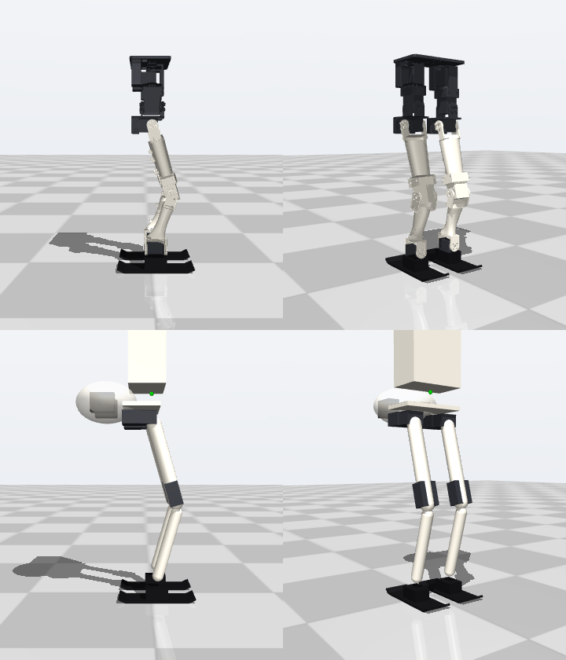
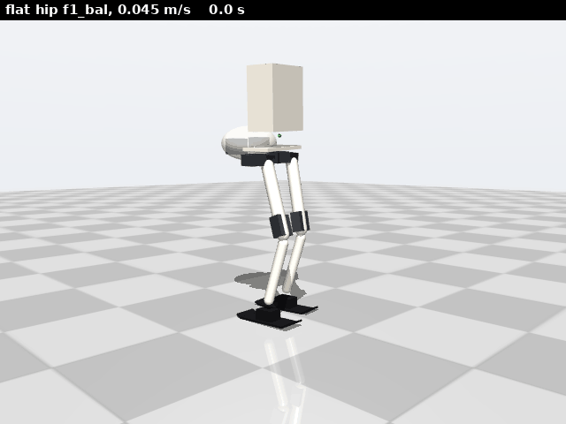

# Leg v2: the flat hip (design study, simulation, 2026-11-17)

*Leg v2 walking in simulation (`f1_bal`, 0.045 m/s command). The model's torso is a placeholder box and the butt
plate is drawn see-through.*

## Why

Today's leg (P0) stacks the hip yaw and hip roll servos vertically above the thigh. From the hip plate to the sole,
with the leg straight:

| hip yaw servo | hip roll servo | thigh | shin | foot |
|---|---|---|---|---|
| 60 mm | 34 mm | 138 mm | 111 mm | 37 mm |

The yaw and roll servos take about a quarter of the leg's length, and the thigh and shin only about two thirds. With
short segments the robot has to swing its thighs far for a useful step.

## The design

The three hip servos lie in a row along the hip plate. From front to back they are pitch, roll and yaw. The
kinematic chain is still yaw -> roll -> pitch. So the joint order, the policy's inputs and outputs, the gait tables
and the robot software all carry over unchanged.

- **Hip pitch servo:**
  - shaft sideways, the body lying fore-aft;
  - its output (the pitch axis) is at the front, 22 mm under the plate.
- **Hip roll servo:**
  - shaft fore-aft, lying sideways behind the pitch servo;
  - the roll axis is a fore-aft line at the pitch axis' height, so it passes through the hip instead of 34 mm above
    it.
- **Hip yaw servo:**
  - shaft vertical, fixed to the pelvis 85 mm behind the pitch axis;
  - it sticks out behind the hip plate, under a round butt plate;
  - the leg yaws about an axis behind the hip, so yawing also moves the foot sideways (~1.5 mm per degree).
- **Thigh and shin:** 178 mm and 144 mm (today 138 / 111) at the same overall height, keeping today's 55 : 45 ratio.
  - The standing pelvis is 370 mm high at today's joint angles (today 373).
  - The robot weighs 1.258 kg (+58 g: longer shells and the butt plate).

Model: `scripts/make_flathip_model.py`.
- `models/hw_flathip_10dof`: as designed.
- `models/hw_flathip_bal_10dof`: the torso and head 42 mm forward, so the robot's centre of mass stays where it is
  today.

Gait tables for it: `shift_gait.py --leg 0.1782,0.17625` (c_F1v8, c_F2t11).

## What the simulation showed

Details in [results/robot20/NOTES.md](../results/robot20/NOTES.md).

- **Less rotation for the same speed.** The same gait swings the hip pitch 29 deg at 0.03 m/s against 36 deg today.
  It needs today's 0.045 m/s swing only at 0.08 m/s.
- **More stable in 2 of 3 matched pairs** (same recipe and steps, only the leg differs; one seed each).

  | pair | upright, leg v2 | upright, today's leg |
  |---|---|---|
  | f1_bal / q6_v6, robot settings | 88-92 % | 75-79 % |
  | f1_bal / q6_v6, loose hips | 62 % | 23 % |
  | f1_bal / q6_v6, slow hips | 83 % | 56 % |
  | f2_fast / q4_fast, robot settings | 81-90 % | 42-60 % |
  | f5_v5 / q7_v5 | failed | trained |

- **Not faster yet.** Its policies walk 17-30 mm/s, like today's leg. The gait tables hold the pelvis still for 60 %
  of the cycle and surge it during each swing at up to 5x the average speed. The ankle-less boards can't follow; the
  body rocks back about 40 % of every surge, on either leg. A longer leg only makes the surge bigger. It needs a
  continuous gait, with the pelvis at a constant speed.

## Requirements if it is built

- **Keep the centre of mass over the hips.** With the yaw servos and the butt behind the hip, the centre of mass sits
  10 mm further back, and no policy walked (`f3_raw`: 0 % up). The fixes:
  - move the torso / battery ~40 mm forward;
  - or make the parts behind the hip lighter.
- **Keep the shin and foot light.** The longer leg is 1.7x harder to swing about the hip pitch (121 against 71 x 1e-4
  kg m^2), and its landings were harder in simulation (285-310 mm/s against 255-275). If it can go there, put the
  knee servo high in the thigh with a linkage to the knee.
- **The yaw servo's bracket:** its output bearing takes the leg's weight 85 mm off its axis, so it needs a supported
  bracket.
