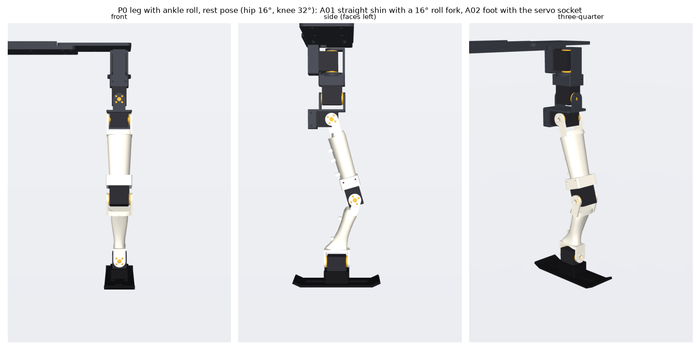
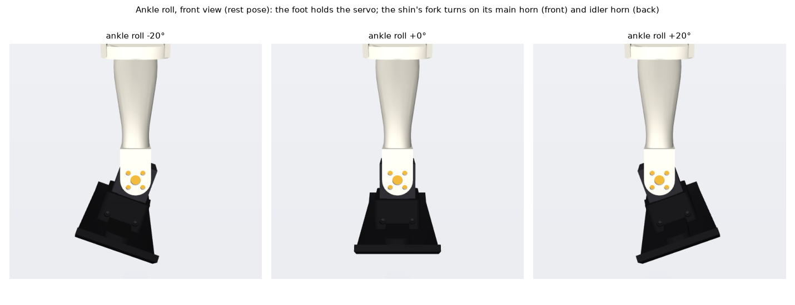
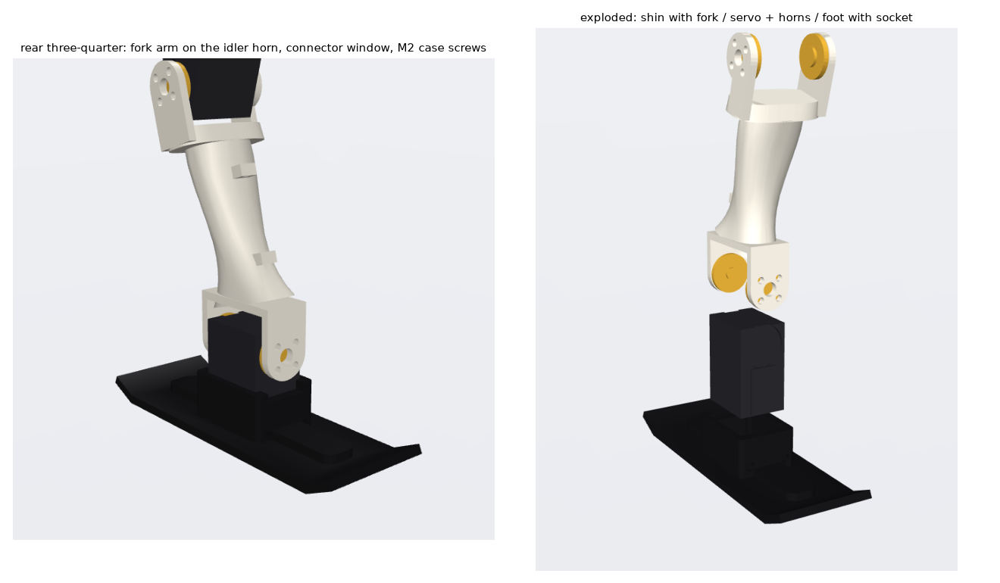

# Ankle P1: ankle roll for the P0 leg

A new straight shin and a new foot that add one ankle roll servo per leg: an STS3215 C001 (1:345, 7.4 V), the same
servo as every other joint. In simulation, ankle roll is the change that made one-foot balance and six-step walking
work ([docs/walking.md §8–9](../../docs/walking.md)). These are new parts: the P06 shin, the P07 pad and the
F_board150w pads are unchanged.

| part | what it is | file |
|---|---|---|
| **A01 shin_ankle** | straight. The P06 knee fork at the top (identical: same knee servo, horns and screws), a straight tube, and a fork at the bottom, angled 16°, whose arms bolt to the ankle servo's main horn (front) and idler horn (back) | `exports/{stl,3mf,step}/A01_shin_ankle.*` |
| **A02 foot_ankle** | the F_board150w sole (150 × 50 mm, last 15 mm each end bent up 25°) with the ankle servo's socket on top, and a rib along the board | `exports/{stl,3mf,step}/A02_foot_ankle.*` |

Right leg: `exports/stl_right_mirror/*_RIGHT.stl` (the mirror image). Print-oriented copies of all four:
`exports/stl/print_ready/`. Assemblies with the servo and horns: `exports/step/ankle_assembly_rest.step` (the rest
pose, hip 16°, knee 32°) and `ankle_assembly_old_stance.step` (the same pose).

## Geometry

* **The socket is on the foot, the roll axis on the shin.** The servo stands upright in the foot, output end up,
  gripped by the lower part of its case (from 14 mm below the axis to its far end, ~21 mm) with 4 × M2×6 case
  screws, 2 through the front wall and 2 through the back. The shin's fork bolts to both horns (8 × M3×6), so the
  idler horn on the servo's rear bearing is the second support, as at every other joint.
* **Straight shin, bent rest pose.** The shin tube is straight; only the ankle fork at its lower end is angled 16°
  (`fork_pitch` in `cad/ankle.py`). In the usual stance (hip 16°, knee 32°) the roll axis is then level, the servo
  stands upright and the board is flat, with no wedge. (A first version stood straight, all joints 0: in simulation a
  flat foot can't be lifted from straight legs without ankle pitch, so it hardly stepped. [docs/walking_ankle.md
  §2](../../docs/walking_ankle.md). `fork_pitch = 0` rebuilds it.)
* **Leg length.** The ankle axis is on the shin centre line, 111.45 mm below the knee, **38.55 mm above the sole**
  along the board normal: the case's far end (35.2 mm below the axis), 0.35 mm clearance and a 3 mm floor.
* Main horn forward, connectors on the back face (a window in the socket's back wall).
* **Range:** the parts don't touch through ±30° of ankle roll (at 35° the shin's transition into the fork meets the
  servo top; the walking policies use less than ±20°). Knee flexion is still clear to 110°, the same as the P06 shin,
  and the knee can bend the other way ("forward") to −90°.

All dimensions come from `hardware/leg_p0/params.yaml` (servo envelope, pocket clearance 0.35 mm, horn and case
screws), so a caliper correction there carries over when you rebuild.

## Mass

| | g per leg |
|---|---|
| A01 shin (est.) | 32.0 (P06: 34.9) |
| A02 foot (est.) | 28.6 (F_board150w: ~25) |
| ankle servo (rides on the foot) | 55 |
| horns and screws (est.) | ~8 |
| **added vs. P06 + F_board150w** | **~64** |

Printed masses are solid volume × 1.24 g/cm³ × 0.55. With the servo in the foot, about 85 g turns with the ankle and
sits right above the board: low leg mass, but more mass to swing for each step than in the simulated design (servo on
the shin, 10 g on the foot).

## Simulation

`scripts/make_ankle2_model.py --bent` builds `models/hw_ank3_<pad>_legs_10dof` from this geometry (mass and inertia
from the CAD, the servo in the foot) with a choice of pads; `scripts/make_ankle2_model.py` (no `--bent`) the straight
version `hw_ank2_*`. Policies and results: [docs/walking_ankle.md](../../docs/walking_ankle.md). Best: the 150 × 50
board as here (`a3s_b150`, `a3w_b150` slow steps).

Note: the sim models allow ±0.6 rad (34°) of ankle roll; these parts are clear to ±30°.

## Printing (Bambu A1)

* **A02 foot:** sole down, socket open upward (`print_ready/A02_foot_ankle_print.stl`). No supports, except under
  the two bent-up board ends (build plate only; a 25° overhang). PLA or PETG, 0.2 mm layers, 3 walls, 25 % infill.
  The case-screw holes in the front and back walls print as horizontal holes.
* **A01 shin:** on its side, outer knee arm on the bed (`print_ready/A01_shin_ankle_print.stl`), as for the P06 shin.
  The tube and the ankle fork are narrower than the knee fork, so they need tree supports. 4 walls, 30 % infill.
  The ankle fork's arms then stand on edge, so the horn holes print as horizontal holes.

## Assembly

Per leg: 1 × STS3215 C001 (1:345, 7.4 V), a driven horn (bought, as on the other joints) and a printed passive horn
(`hardware/leg_p0/cad/horns.py`, 6.25 bore), 8 × M3×6 horn screws, 4 × M2×6 case screws, one servo cable
(~200 mm, knee servo to ankle servo).

1. Set the ankle servo's ID (the next free one) and centre it (position 2048) on the bench before fitting the horns,
   so that 0 is the foot flat.
2. Push the servo into the foot's socket, output end up, main horn (driven) side forward, connectors to the back.
   Fit the 4 × M2×6 case screws through the front and back walls.
3. Fit the driven horn on the output (front) and the passive horn on the idler side (back).
4. Lower the shin's fork over the servo and fit 4 × M3×6 through each arm into the horns.
5. Plug in the cable from the knee servo (through the window in the socket's back wall) and tie it to the two lugs on
   the back of the shin, with a little slack across the ankle.
6. Fit the shin to the knee horns as for the P06 shin.

Software: the 10-joint order is hip yaw, hip roll, hip pitch, knee, **ankle roll**, per leg (`configs/actuators.yaml`
set `hw_p0_c044_pitch_ankleroll`). The left ankle axis is +X (forward). The right leg is the mirror image with the
servo the same way round, so its sign is flipped (as for hip roll). Check both signs with the robot held in the air
before enabling a policy. `policy_stand.py` does not drive the ankle servos yet.

## Rebuild

    .venv-cad/bin/python hardware/ankle_p1/cad/build_ankle.py           # export + check + render
    .venv-cad/bin/python hardware/ankle_p1/cad/build_ankle.py check     # interference / ROM / mass only
    .venv-cad/bin/python hardware/ankle_p1/cad/build_ankle.py simmesh   # visual meshes for the simulator

Parameters (fork pitch, floor thickness, socket grip, rib) are in `ANKLE` at the top of `cad/ankle.py`. Check results:
`verification_report.json`.

## Not verified

* Nothing here has been printed. The pocket, horn and screw dimensions are the leg_p0 ones that fit on the robot.
* The whole robot's weight goes through the foot's socket in single support. Check for play after the first runs.
* Policies exist only in simulation (docs/walking_ankle.md); none has run on the robot, and `policy_stand.py` doesn't
  drive the ankle servos yet.
