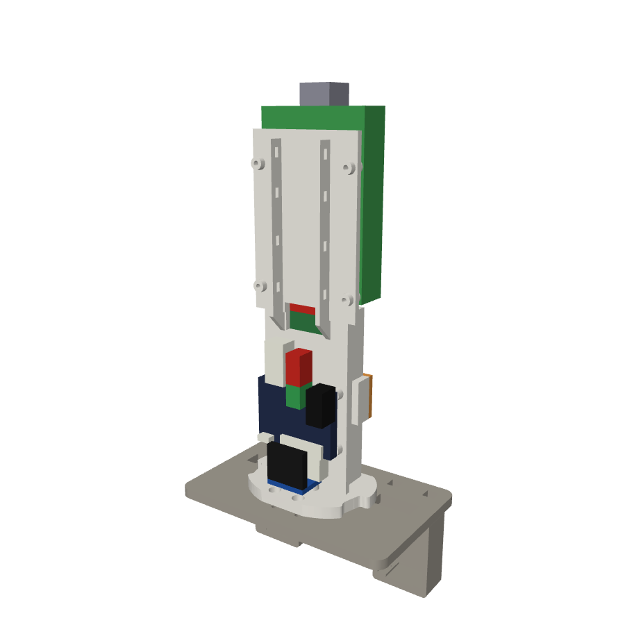
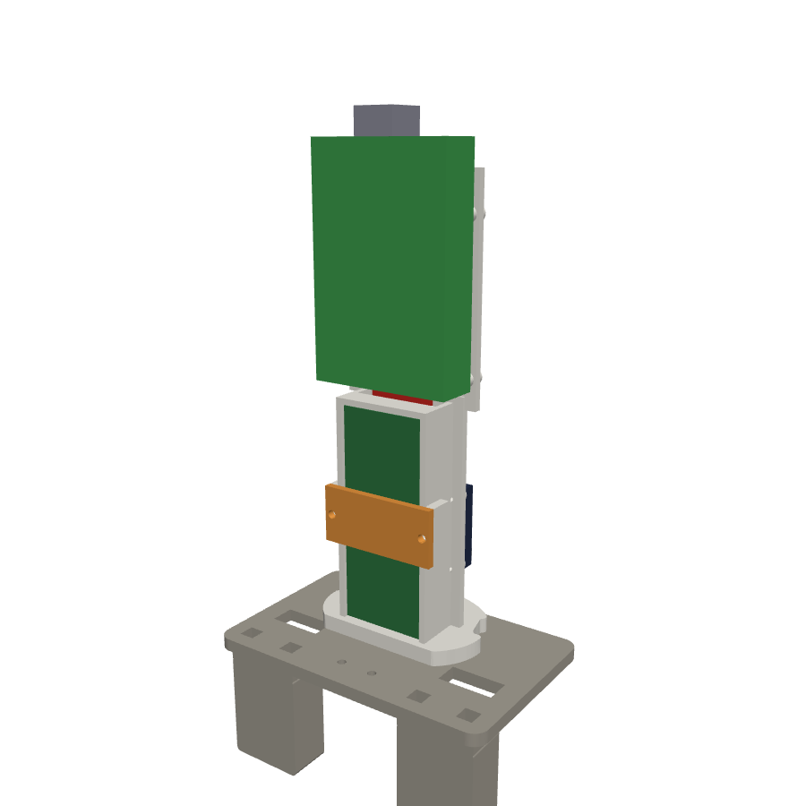
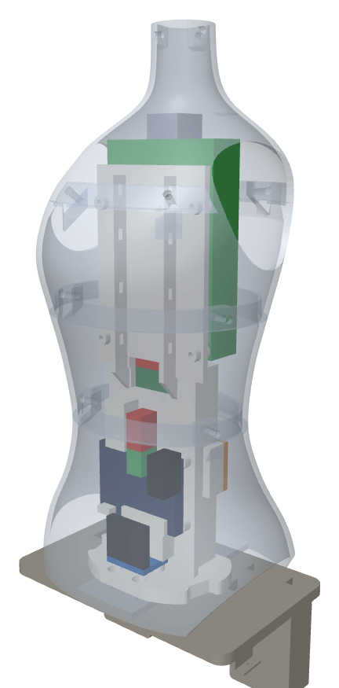

# Electronics mount P0

The mount is one printed spine (E01) that stands on the P08 hip plate inside the T1 torso. It carries:
- the 2S battery;
- the Raspberry Pi 3 B+;
- the Waveshare Bus Servo Adapter (A);
- the IMU, on the mount's base. The base replaces `hardware/imu/cad/imu_slab.py`.

A separate strap (E02) holds the battery. The lever connectors (Wago-style) that split the battery power, and the buck
converter that powers the Pi, hang free on their cables in the front channel.

`cad/mount.py` builds both parts and checks them against the torso, then writes `mount_report.json` and the renders.
It needs the torso's free space, built once by `cad/torso_fit.py`.

  

## Why it stacks

The torso's narrowest point is the T03/T04 seam, 64–94 mm above the plate. Its free outline is about 55 mm front to
back and 72 mm side to side at the centre. It is rounded, so the width drops to about 50 mm at 20 mm behind the centre
and about 36 mm at 24 mm in front.

Only the middle can take the Pi (56 mm wide) and the battery pouch (40 mm), so they stack:
- the battery sits low behind the spine;
- the Pi sits above it, also behind the spine.

The narrow parts go in front of the spine: the IMU on the base and the Waveshare above it. Above the Waveshare, two
ribs make a channel for the lever connectors, the buck converter and the cables.

Heights above the plate, with the mount on T03's 3 mm floor:

| part | height |
|---|---|
| base | 3–9 mm |
| battery | 9–95 mm |
| Pi | 103–190 mm |
| IMU | 12–15 mm |
| Waveshare | 30–62.5 mm |
| spine top | 180 mm |

## Torso fit (checked)

The check follows the assembly order:
1. T03 goes on the plate.
2. The mount is lowered into T03.
3. T04, T05 and T06 are lowered over the mount.

At every height, every part (the boards and their plugs as keep-out boxes) has to pass each tube section that slides
past it. With 1 mm clearance, every tube passes. The one exception is a 1 mm² graze with T06's neck by the box assumed
for the Pi's USB plugs, 200 mm up. It clears with no clearance asked.

`mount_report.json` has the numbers under `torso_fit`. A deliberately oversized part fails the check, so a pass means
something.

## Parts

| part | print orientation | supports |
|---|---|---|
| E01 mount, 69 × 44 × 177 mm | as exported: base on the bed | none expected; use a brim (it's tall) |
| E02 battery strap, 47 × 22 × 3.8 mm | as exported: flat | none |

## Screws and pilots

Every pilot is self-tapping into the print:
- M3: the frame's size, read from `hardware/leg_p0/params.yaml` (`fit.m3_pilot_d`, 2.9 mm, from the torso thread test).
- M2.5: 2.5 mm, for both the Raspberry Pi and the Waveshare. The Waveshare's screws turned out to be M2.5 too: they
  hold in a 2.5 mm hole.

To check the M2.5 size, print `fit_tests/m25_thread_test_print.stl`, a 22 × 10.5 × 3 mm plate with holes at
2.4 / 2.5 / 2.6. If another size grips better, set `M25_PILOT` in `cad/mount.py` and rerun it.

| what | screws |
|---|---|
| base, all four plate holes: (0, ±7) and (22, ±7) | 4 × M3 down through 3.4 mm counterbored holes, through T03's floor and the plate. The middle pair go into the nuts under the plate (they replace T03's two middle floor screws); the front pair go into the front hip panel's ear nuts. M3x14 with the torso (M3x16 if an ear nut doesn't catch); M3x12 with nuts without it. |
| battery strap | 2 × M3x10 into the thickened pouch walls |
| Raspberry Pi | 4 × M2.5x10. The pilots run through the 3 mm standoffs, the spine and the 3 mm bosses on the front. |
| Waveshare | 4 × M2.5x8, on 4 mm standoffs |
| IMU | 2 × M3x6 or M3x8, on the slab's 3 mm bosses |

## Wiring this layout needs

- **Pi power.** The micro-USB plug would stick out sideways past the waist, so power the Pi through the GPIO header:
  5 V on pin 2 or 4, GND on pin 6. Those pins are at the header's bottom end. Their leads come through the slot
  between the battery and the Pi.
- **Pi USB.** The ports face up, with only about 10 mm free above them before the neck. Use right-angle USB-A plugs,
  one for the Waveshare's USB-C and one for the IMU's RP2040. Their cables run over the spine top to the front channel.
- **Battery.** The leads leave the battery's top next to the spine. The pouch's top wall is 10 mm deep at the back,
  which leaves the 8 mm along the spine open for the leads. They go through the slot to the lever connectors in front.
- **Waveshare.** The servo sockets face down, so the servo leads run down past the base and out through T03's side
  openings. The USB-C and DC terminals face up toward the front channel.
- **Cable ties.** Four holes through each front rib.

## Assembly

1. Set the empty mount on T03's floor. Without the torso, set it on the plate.
2. Drive the four base screws down through the counterbores. Do this first: the middle pair are reached straight down
   the pouch, past the spine's back face, and the IMU and the Waveshare cover the front pair.
3. Fit the IMU, the Waveshare and the Pi.
4. Put the battery in the pouch, leads up and against the spine. Screw the strap across the back. A pad on the strap
   leaves 0.2 mm to a 17.0 mm pack, so add foam if the pack is thinner.
5. Wire the lever connectors, the buck converter and the plugs, then lower T04, T05 and T06 over the mount.
6. Rerun `python policy_stand.py imu-calib`. The IMU has moved and turned.

## Mass and the simulator

The estimate is about **243 g**:

| item | g | source |
|---|---|---|
| E01 print | 41 | about 60 % solid |
| strap | 3 | |
| battery | 112 | listing |
| Pi | 50 | |
| Waveshare | 10 | |
| IMU | 3 | |
| lever connectors and buck converter | 20 | guess |
| screws | 4 | |

The centre of mass is about 80 mm above the plate top, 2.7 mm behind the hip-yaw axes and on the centreline. The
simulator's model is about 1.08 kg, with a 20 g placeholder for the pelvis electronics
(`EXTRA["pelvis_electronics"]` in `hardware/leg_p0/cad/sim_model.py`). So the mount adds about 21 %, high up, and the
torso shell adds more. Weigh the parts, add them to the model with the IMU site at its new place, and retrain before
trusting the current policies.

## Not verified

- Nothing here has been printed yet.
- The 2.5 mm M2.5 pilots haven't been tried in a printed standoff yet.
- These come from photos and estimates:
  - the Waveshare's outline and connector positions;
  - the plug sizes (USB-C, servo plugs, IMU header);
  - the Pi's USB-plug clearance.
- The servo-lead route out of the torso and the buck converter's size aren't modelled.
- The torso shell itself has not been printed (see `hardware/torso_p0`).
