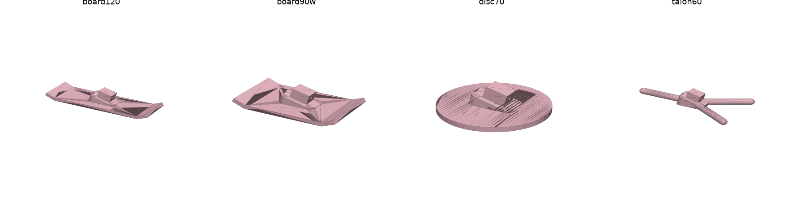

# Feet P1: big pads for soft rugs

Larger replacement pads for the P07 foot pad. They plug into the unchanged shin tips: each pad is the original
pad's stem and 16° wedge with a bigger sole fused under it. The sole sits in the original sole's plane, so the
robot stands at the same height and in the same pose. Why and how they were chosen: [docs/foot_pads.md](../../docs/foot_pads.md).

## Which one to print

**`F_board150w`**: a snowboard, 150 × 50 mm, with the last 15 mm at each end bent up 25°. In simulation it stands
by itself (servos only holding the stance pose) when set down up to 8° off vertical on any rug, so it does not
depend on the policy transferring well. Policies: `pad_board150w_legs` for the robot as tested (legs and pelvis;
100 % of simulated hand placements up to 7° on every rug) and `pad_board150w` with torso and head on.

`F_board120w` (120 × 50 mm) is the smaller alternative: about the same catch rate with its policy
(`pad_board120w`), but it leans on the policy for it. The other files are the designs it was compared with; the 60
and 90 mm boards, the round pads, the claws and the talons all did clearly worse on soft rugs.

Print two of the same file: the pad is symmetric, so it fits either leg.

## Printing (Bambu A1)

* `exports/F_<design>.3mf` (or `.stl`), already oriented: boards lie **on their side**, so every layer is the
  board's side profile. The upturned ends need no supports, and the layers run along the board, the strong way.
* PLA or PETG, 0.2 mm layers, 3 walls, 25 % infill, a brim helps the 50 mm tall side-printed board stay put.
* About 25 g each for `F_board150w`, 21 g for `F_board120w` (the original pad is ~5 g). The 150 mm board fits the
  A1's 256 mm bed easily.

## Fitting

These pads have the new two-screw stem (2 × M3×10, front and back), so they need the reprinted P06 shin with the
matching holes (`hardware/leg_p0/exports`, 2026-11-08). An old M2 shin will not hold them.

1. Remove the old pad: undo the screw at the back of the shin tip and pull the pad out.
2. Push the new pad's stem into the shin tip **the same way round as the old pad**: the stem fits both ways, but the
   16° wedge does not. The wedge is thickest at the heel (back), so with the leg straight the sole tilts toe-up; in
   the stance pose (knees bent) it then sits level.
3. Drive one M3×10 through the front of the shin tip and one through the back, into the stem's 2.9 mm pilot.
   The heads sit on flat spot faces. Snug them up, but don't crank them: they self-tap into plastic.
4. Check that the two pads clear each other: they are 50 mm wide on legs 81 mm apart, so they are 31 mm apart
   at rest. Hip yaw and roll can bring them closer; the simulator models their collision.

## Not verified

* Nothing here has been printed. The stem is copied from P07, so it should fit the socket the same way.
* The rug model is a soft MuJoCo contact calibrated to sink ~3–10 mm under the original pad; real fur also drags
  sideways and varies a lot from rug to rug.
