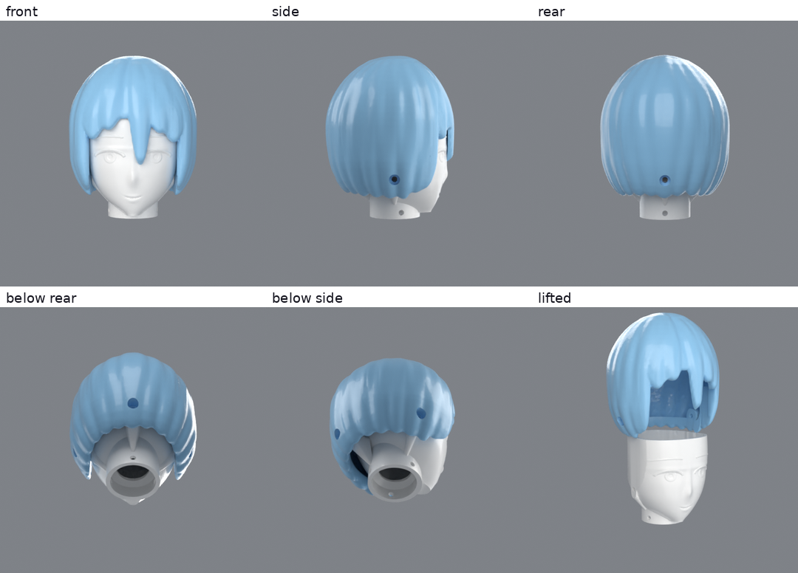

# Head P0

Head H1 is two printed parts. The face part bolts over the top of the T06 neck, and the hair cap lifts straight up off it, which opens the
inside of the head for parts such as a micro camera. `cad/head.py` builds both from parameters and writes `head_report.json`.
`cad/render_paint.py` renders `renders/paint/`, which is not part of the print.

## Print

Both files in `exports/print_ready/` are already upright and centred for a 256 mm bed. Neither has a closed cavity, so any support you add can be pulled out.

| | `H01_face_print.stl` | `H02_hair_print.stl` |
|---|---|---|
| size | 61 x 54 x 64 mm | 82 x 82 x 88 mm |
| stands on | the neck socket ring | the hair hem |
| supports | tree, a small patch under the chin | tree, under the hem and across the top of the face window; block them inside the cap |
| adhesion | brim | brim on the supports |
| walls, infill | all walls, no infill needed in most of it | 3-4 perimeters, 10-15 % infill |

Roofs inside the hair cap are 45 degrees, apart from a small flat patch at the top that bridges. Print the thinnest hair tips, about 1 mm, slowly.

The report's 160 g (30 g face, 129 g hair) assumes every part of the model is solid plastic, so the real print should be lighter with low infill.

## Fit

| joint | screws | how |
|---|---|---|
| face to neck | 3 x M3x6 | through the 3.4 mm collar holes into the neck's 2.9 mm pilots: back and both sides. The socket slides over the top 8 mm of the neck and stops on a 45 degree seat at the rim |
| hair to face | 3 x M3x12 | straight in through the hair into 2.9 mm pilots in the face part's pads: back and both sides |

The hair screws are meant to show, like the screws on the torso seams. Their heads sit about 4 mm deep in recesses low on the hair, and a driver reaches them with the head on the robot. A small rib under each screw's pad, needed to print it without supports, shows below the hem.

The hair cap has 0.25 mm clearance per side on the face part, and rests on the face part's rim. Tighten the screws until snug, because the side screws pull against each other across that clearance. The 20 mm passage above
the seat keeps the neck's 18.5 mm clear circle open into the head.

## Face

Eyes, brows, nose and mouth are low relief, to guide painting: the lid and iris are raised 0.65 and 0.35 mm, and the pupil and mouth are engraved 0.25 and 0.5 mm. The corners of the
mouth rise about 0.95 mm above its middle. There are no printed markings. `renders/paint/` shows colour and marking ideas.

## Not verified

- Nothing in this two-part version has been printed. The socket fit, the cap's fit and the relief details are untested, and the thinnest hair tips may be fragile.
- The screw pilots use the 2.9 mm size from the torso thread test, but print sideways here, so they may grip a little differently.
- The walking policies include neither the torso nor this head. It adds up to 160 g with its centre of mass about 55 mm above the neck rim, so retrain before walking with it on.
