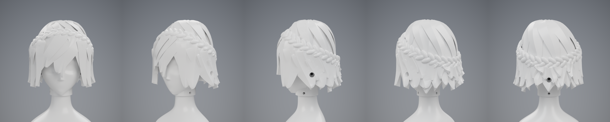
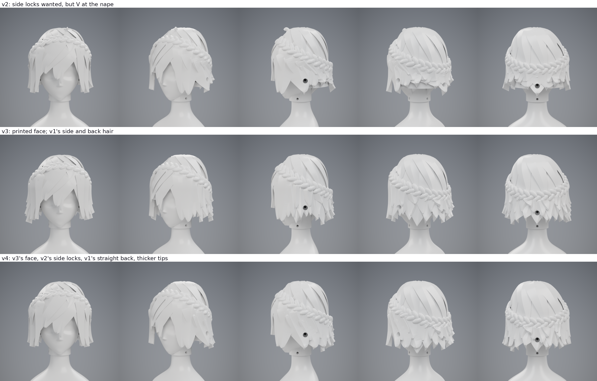

# Head P1: H2 "Rebel Princess"

Head H2 follows my Rebel Princess concept: short layered hair with broad, pointed locks and a crown braid. The face only
carries shape (brow ridge, flat-floored eye sockets, nose bridge and tip, cheekbones, chin), because the eyes, brows and
mouth are stickers. It mounts like H1: a face part slides over the T06 neck, and a hair cap lifts straight up off it.

Each design pass is kept whole in `versions/`, with its own build script, print files, fit report and renders. **Version 4 is current.**

| version | hair | face | status |
|---|---|---|---|
| [v1](versions/v1/README.md) | narrow layered locks, two ear units | first pass, with screw pads for the ear units | superseded |
| [v2](versions/v2/README.md) | broad triangular locks, drawn into a V at the nape | same file as v3 | superseded |
| [v3](versions/v3/README.md) | v2's crown and bangs, v1's layered sides and back | **printed** | hair not printed |
| [v4](versions/v4/README.md) | v2's broad locks at the sides, v1's straight back, tips at least 2.5 mm wide | same file as v3 | ready to print |

The face file is the same in v2, v3 and v4. v4's `H11_face_print.stl` is byte-identical to v3's, so v4's hair fits a face printed from v3.

Each version builds from its own folder:

    .venv-cad/bin/python hardware/head_p1/versions/v4/cad/head.py --assembled <dir>
    .venv-render/bin/python hardware/head_p1/versions/v4/cad/render.py <legs_dir> <assembled_dir>
    .venv-render/bin/python hardware/head_p1/versions/v4/cad/render_stickers.py <legs_dir> <assembled_dir>

`<assembled_dir>` must also hold the torso from `torso.py --assembled`. The sticker renders are previews only: they are not
sticker artwork files.
