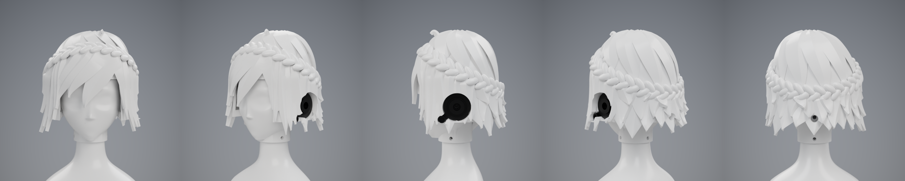

# Head P1: H2 "Rebel Princess", version 1

Head H2 follows the Rebel Princess concept: layered short hair, a crown braid, and two ear units. The face carries only
shape (brow ridge, flat-floored eye sockets, nose bridge and tip, cheekbones, chin), because the eyes, brows and mouth are
stickers. `cad/head.py` builds every part from parameters and writes `head_report.json`. `cad/render.py` renders `renders/`.

## Parts

| file | part | print |
|---|---|---|
| `H11_face_print.stl` | face and skull; slides over the T06 neck like H1 | upright on the socket ring; tree supports under the chin |
| `H12_hair_print.stl` | hair cap with the crown braid | upright on the hem; tree supports under the lock tips and across the face window; block them inside |
| `H13_ear_left_print.stl`, `H13_ear_right_print.stl` | ear units, mirrored | on their backs, no supports |

The parts are already oriented for a 256 mm bed. Paint the ring groove gold, or later fit a light guide there.

## Assembly

| joint | screws |
|---|---|
| face to neck | 3 x M3x6 through the collar, as H1 |
| hair cap to face, back | 1 x M3x12 straight in, head recessed in the hair |
| ear unit, hair cap and face, each side | 1 x M3x16 through the ear unit's centre, so each ear unit also clamps the cap |

A peg on each ear pad keys its unit so the lens pod points forward and down. All pilots are 2.9 mm, the torso's thread-test size.

## Checks (`head_report.json`)

No part overlaps another or T06, the cap lifts 70 mm off the face, and each ear unit slides straight out. Each screw passes
untouched through the parts it clamps, gets 5.3-5.5 mm of full thread with 1 mm spare depth, seats its whole head, and
leaves a clear 60 mm driver path. The neck's cable opening stays clear.

The model weighs 219 g if solid (face 31 g, hair 183 g, ears 2.6 g each). With three perimeters and 15 % infill the
estimate is about 131 g, inside the concept's 120-160 g target.

## Not verified

- Nothing has been printed. The cap and ear fits, the braid lobes and the thin lock tips are untested.
- Stickers need a gently curved surface: the eye sockets have flat floors for this, but sticker size and fit are untested.
- The walking policies include neither the torso nor a head.
