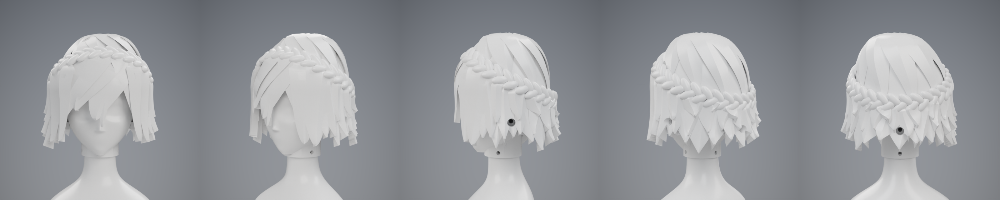

# Head P1: H2 "Rebel Princess", version 3

Version 3 is version 2 with version 1's layered hair at the sides and back; the crown, bangs, face framing, braid and screws are version 2's. The face
carries only shape (brow ridge, flat-floored eye sockets, nose bridge and tip, cheekbones, chin), because the eyes, brows
and mouth are stickers. `cad/head.py` builds both parts from parameters and writes `head_report.json`. `cad/render.py`
renders `renders/`.

## Parts

| file | part | print |
|---|---|---|
| `H11_face_print.stl` | face and skull; slides over the T06 neck like H1 | upright on the socket ring; tree supports under the chin |
| `H12_hair_print.stl` | hair cap with the crown braid | upright on the hem; tree supports under the lock tips and across the face window; block them inside |

Both are already oriented for a 256 mm bed. The concept's ear units are left out: the sides are covered by hair.

## Assembly

| joint | screws |
|---|---|
| face to neck | 3 x M3x6 through the collar, as H1 |
| hair cap to face | 3 x M3x12 straight in at the back and both sides, heads recessed in the hair |

All pilots are 2.9 mm, the torso's thread-test size.

## Checks (`head_report.json`)

The parts don't overlap each other or T06, and the cap lifts 70 mm straight off the face. Each screw passes untouched
through the hair, gets about 5.3 mm of full thread with 1.1 mm spare depth, seats its whole head, and leaves a clear 60 mm
driver path. The neck's cable opening stays clear. Both saved files reload as single closed solids.

The model weighs 223 g if solid (face 30 g, hair 193 g). With three perimeters and 15 % infill the estimate is about 131 g.

## Not verified

- Nothing has been printed. The cap fit, the braid lobes and the lock tips (at least 1.3 mm wide) are untested.
- Stickers need a gently curved surface: the eye sockets have flat floors for this, but sticker size and fit are untested.
- The walking policies include neither the torso nor a head.

