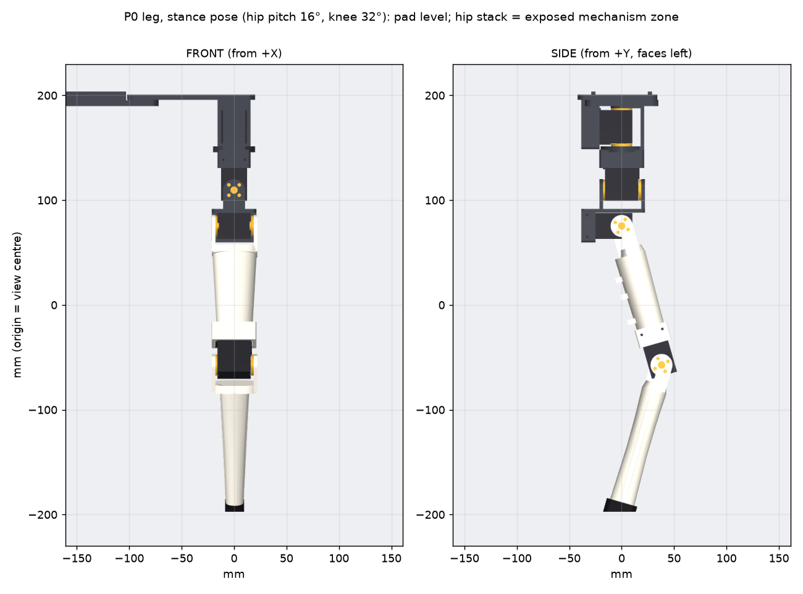
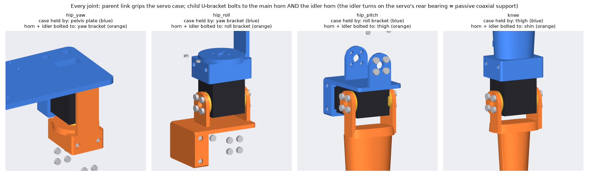
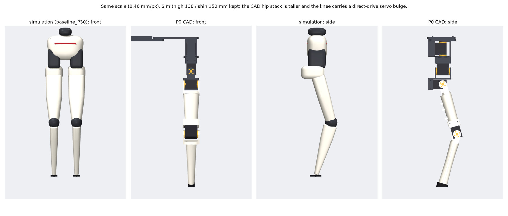

# P0 leg: one printable, direct-drive 4-DoF leg on a bench fixture



**Milestone P0:** print and assemble one leg (hip yaw, hip roll, hip pitch, direct-drive knee) on a
desk-clamped pelvis fixture, and move each joint safely **unloaded**. Standing and walking are out of
scope. Nothing here is load-bearing certified.

- **Side:** this is the **left** leg. Mirrored right-leg STLs are in `exports/stl_right_mirror/` for
  later; no second-leg servos are assumed.
- **Servos:** 4 × Feetech STS3215-C001 (1:345). The other 2 owned servos are spares.
- **Contact:** a 30 × 18 mm flat pad. There is no ball tip, ankle or foot.

## Regenerate everything

```bash
uv venv -p 3.12 .venv-cad && uv pip install --python .venv-cad/bin/python build123d pyyaml numpy trimesh matplotlib mujoco==3.3.7 imageio
.venv-cad/bin/python hardware/leg_p0/cad/build.py        # STL / 3MF / STEP, renders, checks (~1 min)
.venv-cad/bin/python hardware/leg_p0/cad/coupons.py      # fit-test coupons
```

All dimensions live in [`params.yaml`](params.yaml). Edit a value, rebuild, and reprint only the
affected part.

## Files

| path | contents |
|---|---|
| `cad/leg.py` | parametric geometry (build123d): servo dummy, cradles, U-brackets, tubes, pad, fixture, kinematics |
| `cad/build.py` | exports, renders, interference and range-of-motion checks |
| `cad/coupons.py` | calibration coupons |
| `exports/stl/`, `exports/3mf/` | one printable file per part, `P01`…`P07`, in assembly orientation |
| `exports/stl/print_ready/` | **send these to the printer**: parts rotated into print orientation, centred on a 256 mm bed (added as each part is printed; `PRINT_DOWN` in `cad/build.py`) |
| `exports/step/` | per-part STEP files, `assembly_neutral.step`, `assembly_stance.step` |
| `exports/*/NOT_PRINTABLE_servo_dummy_STS3215.*` | servo dummy, for clearance checks only |
| `exports/stl_right_mirror/` | mirrored parts for a future right leg |
| `fit_tests/` | coupons A–E (print these first) |
| `renders/` | front/side/three-quarter renders (neutral and stance), exploded view, per-joint diagram, sim comparison |
| `BOM.csv` · [`assembly.md`](assembly.md) · [`verification.md`](verification.md) | parts list, beginner assembly guide, checks and caliper checklist |
| `verification_report.json` | machine-readable output of the last check run |
| `software/` | `feetech_bench.py` + `bench_config.yaml`: scan, ID setup, read, single-joint moves, logged low-amplitude test |

## Architecture: what holds what



Every joint uses one pattern, the classic hobby-humanoid servo bracket chain:
- **Case:** the **parent** link holds the **servo case** in a cradle that grips only its far end
  (≥ 21 mm from the output axis). The cradle has a snug pocket plus 4 × M2×6 self-tapping screws into
  the case's own mounting holes (counterbored to leave 2 mm of wall under each head). Horn arms take
  M3×6 screws, as on the SO-101 arm, which uses the same servo.
- **Horns:** the **child** link is a U-bracket whose two arms bolt to the **main horn** and to the
  **idler horn**.
- **Support:** the idler horn turns on the servo's rear bearing, so every joint has a **passive
  coaxial support** without a separate bearing that could be misaligned.

| joint | axis (+ direction) | case held by | horns bolted to | supported by |
|---|---|---|---|---|
| hip yaw | +Z (toe outward) | P01 pelvis plate (cup) | P03 yaw bracket | main horn below + idler horn above |
| hip roll | +X (abduction) | P03 yaw bracket (saddle) | P04 roll bracket | main horn front + idler horn back |
| hip pitch | −Y (flexion = foot forward) | P04 roll bracket (cradle) | P05 thigh (fork) | main horn outside + idler horn inside |
| **knee** | +Y (flexion = foot backward) | **P05 thigh** (cradle at the distal end) | **P06 shin** (fork) | main horn outside + idler horn inside |

**Direct-drive knee:** the knee servo sits in the bottom of the thigh. The shin fork bolts straight to
its two horns, with no belt, pulley or gear stage. The servo stays exposed as one local bulge at the
knee; it isn't hidden by widening the thigh or shin.

Sign conventions match the simulation (`configs/geometry.yaml`). Neutral pose (all joints 0) = straight
leg. "Stance" = hip pitch 16°, knee 32°, where the pad is level.

## Geometry versus the simulated leg



| | simulation (`baseline_P30_8dof`) | P0 CAD | why |
|---|---|---|---|
| thigh: hip pitch → knee | 138 mm | **138 mm** | kept |
| shin: knee → pad underside (heel) | 150 mm | **150 mm** | kept |
| knee drive | remote, belt | **direct drive** | P0 decision |
| servos | C046 (7.4 V, 106 rpm) + STS3032 yaw | **4 × C001** (1:345, 52 rpm at 7.4 V) | owned hardware: about half the speed of the sim's servo, fine for P0 but not for walking |
| hip yaw → roll axis | 37 mm | **60.4 mm** | the roll servo hangs fully below the yaw bracket; 3 mm extra so the yaw bracket clears the cup |
| roll → pitch axis | 26 mm | **34.2 mm** | the pitch servo lies under the roll bracket web |
| hip axes | near one point | **yaw ∩ roll and yaw ∩ pitch; roll and pitch offset 34.2 mm** | both the roll and pitch axes cross the vertical yaw axis line (at 60.4 and 94.6 mm below the yaw servo centre); roll and pitch don't meet each other |
| hip spacing | 60 mm | **60 mm** | kept (fixture has the mirrored mount pattern) |
| thigh width (front) | 44 → 26 mm | **42 → 34 mm**, knee cradle 42 mm | the 32 mm-thick knee servo sets the minimum knee width |
| shin width (front) | 22 → 11 mm | **28 → 17 mm** | fork merges into a tapered tube |
| contact | 30 × 18 mm pad | **30 × 18 mm pad**, replaceable, level at stance | kept |
| leg mass on the fixture | — | ≈ **408 g** (163 g printed + 4 × 55 g servos + 25 g hardware) | estimate |

## Range of motion (automated sweep, no collisions including screw heads)

| joint | sim range | CAD collision-free | software limit (`bench_config.yaml`) | what stops it |
|---|---|---|---|---|
| hip yaw | −20…30° | **−20…30°** (full) | −15…25° | — |
| hip roll | −14…30° | **−14…30°** (full) | −10…25° | — |
| hip pitch | −35…100° | **−30…85°** | −25…80° | thigh crotch reaches the roll-bracket web |
| knee | 0…130° | **0…110°** | 0…105° | shin fork reaches the knee-servo case |

## Design compromises (flagged, not hidden)

1. **Unverified servo geometry.** Dimensions come from the Feetech datasheet and the SO-ARM100
   STEP model (Apache-2.0). Horn thread size, case screw size and depth, and horn face heights must
   be measured before the real parts are printed. See the caliper checklist in
   [`verification.md`](verification.md).
2. **Tall hip stack.** The hip is about 95 mm from the yaw servo centre to the pitch axis, against
   63 mm in the sim. This is the permitted messy zone. A later revision could turn the roll servo
   sideways to save about 30 mm, at the cost of width.
3. **Connector clearance.** The bus connectors sit on each servo's idler face, about 14 mm from the
   axis. So the inner fork arms of the thigh and shin are cut back behind the axis, and the
   hip-pitch and knee ranges stop short of the sim's.
4. **Wide knee.** The 31.8 mm servo thickness plus horns makes the knee about 43 mm wide in front
   view. It is an honest local bulge; the tube above and below stays slender.
5. **Not load-bearing.** The 3.5 mm arms and the hollow 2.2–2.4 mm-wall tubes are sized for
   unloaded motion and appearance, not for standing.
6. **Pad.** The pad is printed rigid. The underside is pitched 16° so it is flat at the stance pose.
   A TPU or rubber skin can be added later.

## Print settings (recommendations, not strength guarantees)

| part | material | orientation | supports | walls / infill |
|---|---|---|---|---|
| coupons A–E | the filament you'll use | flat | none | as for the real part |
| P01 pelvis plate | PETG (or PLA) | plate face down, cup walls up | none (the cup floor bridges ~26 mm) | 4 / 30 % gyroid |
| P02 clamp tongue | PETG / PLA | flat, ribs up | none | 3 / 25 % |
| P03 yaw bracket | PETG preferred | front web face down | tree supports under the round boss and saddle | 4 / 40 % |
| P04 roll bracket | PETG preferred | pitch-cradle back face (−X) down, arms flat so horn holes print round | tree supports under both arms | 4 / 40 % |
| P05 thigh | PLA or PETG | on its side, one fork arm (+Y) on the bed; the body sits 0.9 mm up | tree supports under the body, tube and upper fork arm | 3 / 15 % (4 walls for loads) |
| P06 shin | PLA or PETG | upright, tip on the bed, fork up | none | 3 / 15 % |
| P07 pad | PLA/PETG now, TPU 95A later | on its long side | none | 3 / 30 % |

0.4 mm nozzle, 0.2 mm layers (0.16 mm for coupons and brackets if the hole fit is poor). Hide the
seam toward the back or inside.

PLA is fine for the bench P0 (P03 in PLA fits and sweeps cleanly). PETG is preferred for the brackets
because PLA softens from about 55 °C and creeps under steady load; a servo case working hard can get
that warm. Reprint the brackets in PETG before long powered holds or standing tests.

## Not done in P0

- No MuJoCo model of this exact geometry yet. When it's made, it should use the C001 speed, the new
  hip offsets and the knee servo mass at the knee.
- No retrained policy. **Do not run the simulation policies on this leg.**
