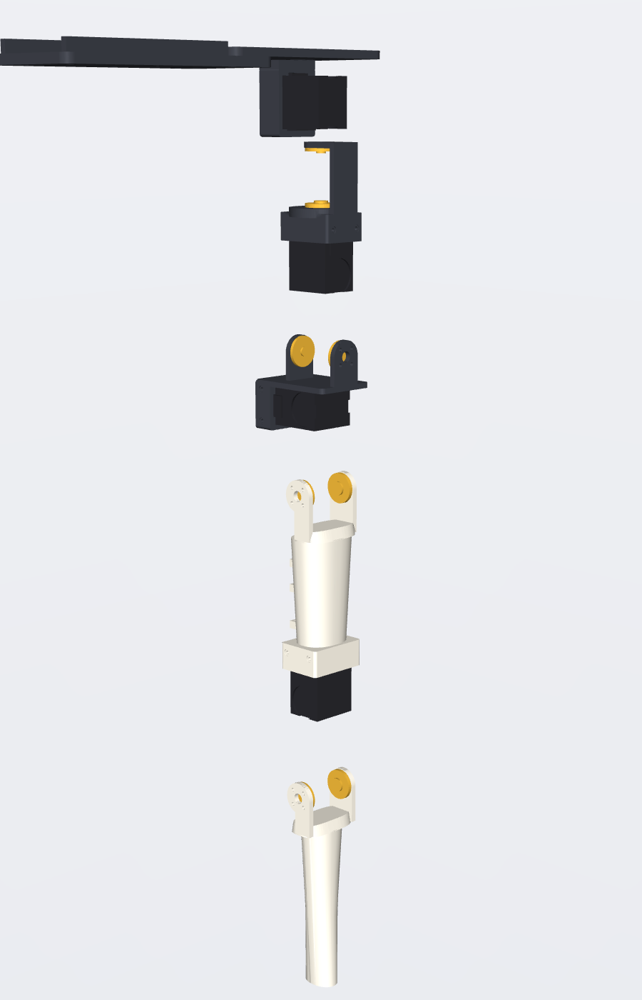

# P0 leg: assembly and first-motion guide

Written for a first robot build. Read the whole guide once before starting. Parts are numbered `P01`…`P07`
(see [`BOM.csv`](BOM.csv)); renders are in [`renders/`](renders/).

 

**Two words used throughout:**
- **case-fixed:** a printed part grips the servo's body (the *case*) and does not move relative to it.
- **horn-driven:** a printed part is screwed to the servo's rotating *horns* and turns with the output.
  Every joint has one of each. The main horn and the idler horn on the opposite face share one axis,
  so the bracket is supported on both sides.

**Safety rules for the whole session:**
- Keep the power switch within reach.
- Never plug or unplug servo cables with power on.
- Keep fingers out of joints whenever torque is enabled.
- Software stop is not an emergency stop: use the switch.

---

## 1. Print the coupons and calibrate

Print the four coupon files in [`fit_tests/`](fit_tests/) in the filament you will use (about 1 h total).

| coupon | test | if it fails |
|---|---|---|
| **A** case pocket gauge | slide each window (1/2/3 notches = 0.25/0.35/0.45 mm clearance) over the servo case from its far end (the end without the output). Pick the tightest window that slides on by hand without force. | set `fit.pocket_clearance` to that window's clearance |
| **B/C** horn and idler arms | screw arm B (no notch) to a main horn and arm C (one notch) to an idler horn with your M2 screws. Holes must line up with no forcing; the centre hole must clear the M3 horn screw head. | adjust `servo.horn_hole_offset`, `fit.m2_clear_d` or `servo.horn_center_screw_head_d` |
| **D** holes and nuts | find the M2 clearance hole your screw slides through (2.2/2.4/2.6), the M3 clearance (3.2/3.4/3.6) and the nut trap that holds an M3 nut snugly (5.5/5.7/5.9 AF) | set `fit.m2_clear_d`, `fit.m3_clear_d`, `fit.m3_nut_af` |
| **E** pad socket | stem should slide in with light friction | edit `pad.stem` |

Then take the caliper measurements in [`verification.md`](verification.md#caliper-checklist), edit
[`params.yaml`](params.yaml) and rebuild:
`.venv-cad/bin/python hardware/leg_p0/cad/build.py`. Only reprint what changed.

## 2. Print the parts and dry-fit without power

1. Print P01–P07 using the [print settings](README.md#print-settings-recommendations-not-strength-guarantees).
2. Remove supports, and clear every screw hole with a 2 mm / 3 mm drill bit turned by hand.
3. Without screws, push each servo into its pocket and check it seats fully:
   - yaw into the P01 cup;
   - roll into the P03 saddle;
   - pitch into the P04 cradle;
   - knee into the P05 cradle.
4. Hold each U-bracket against the horns and check that the arms touch both horn faces without
   pinching the case.
5. Bolt **P02 tongue** under **P01** (4 × M3×16 from the top, nuts in the tongue's hex traps).

## 3. Install the yaw, roll and pitch motors

**First, centre and horn every servo.** Do this one servo at a time, using the tools in step 5:
1. Assign the servo its ID.
2. Command it to 2048 (centre).
3. Press the main horn onto the spline so its 4 holes form a square aligned with the case edges.
4. Fit the M3×6 horn screw.
5. Fit the idler horn on the rear boss.

Disconnect power before mechanical work.

**Hip yaw:** case-fixed = P01 pelvis plate; horn-driven = P03 yaw bracket.
1. Slide P03 onto the yaw servo from the output end. Its lower arm goes on the main horn and its
   upper arm on the idler horn.
2. Fit the **4 lower-arm screws** from below, through the counterbores inside P03's saddle pocket.
   Fit the **4 upper-arm screws** from above. Both sets become hard to reach later, so do them now.
3. Slide the servo, bracket attached, backward into the P01 cup until its far end touches the end
   wall.
4. Fit 2 × M2×8 self-tapping screws down through the access holes in the plate, and 2 more from
   below into the bottom face. Don't overtighten: these cut threads into the servo case.

**Hip roll:** case-fixed = P03 saddle; horn-driven = P04 roll bracket.
1. Push the roll servo (output end down) up into P03's saddle.
2. Fit 4 × M2×8 through the saddle walls: 2 front, 2 back.
3. Slide P04 up from below so its front arm meets the main horn and its back arm the idler horn.
4. Fit 8 × M2 horn screws.

**Hip pitch:** case-fixed = P04 cradle; horn-driven = P05 thigh fork.
1. Slide the pitch servo (output end forward, main horn **outward**) into P04's cradle.
2. Fit 4 × M2×8 through the cradle walls.
3. Leave the thigh off until step 4.

## 4. Build the thigh–knee–shin and hang it on the hip

**Knee (direct drive, no belt):** case-fixed = P05 thigh cradle; horn-driven = P06 shin fork.
1. Push the knee servo (output end down, main horn **outward**) up into the cradle at the bottom of
   P05.
2. Fit 4 × M2×8 through the cradle walls.
3. Slide the P06 shin fork up onto the knee horns.
4. Fit 8 × M2 horn screws. The inner (idler-side) fork arm is deliberately short at the back: it
   must not touch the knee servo's connector.
5. Push the **P07 pad** stem into the shin tip with the long side front-to-back and the thicker edge
   at the **back**. Fit 1 × M2×8 through the back of the shin tip.

**Hang the thigh:**
1. Slide the P05 fork up onto the pitch horns, main horn outside and idler inside.
2. Fit 8 × M2 horn screws.
3. Check by hand, with power off and screws snug:
   - each joint turns only by back-driving the servo;
   - nothing rubs;
   - the passive idler side turns freely with no binding (it is on the same axis as the output).

If an arm binds, loosen its 4 screws, let it centre itself, and retighten.

## 5. IDs, neutral and limits (links unloaded)

Use the Feetech bus adapter and [`software/feetech_bench.py`](software/feetech_bench.py):
```bash
pip install feetech-servo-sdk pyyaml
```

1. **Wiring check, before any servo is connected:**
   - measure the supply with a multimeter: 5 V, polarity correct at the adapter's power terminals;
   - check the 3-pin order (GND, VCC, SIGNAL) on every cable.
2. **IDs:** connect **one servo only**, then:
   ```bash
   python feetech_bench.py scan
   python feetech_bench.py set-id --old 1 --new N --i-have-only-one-servo-connected
   ```
   Use N = 1 yaw, 2 roll, 3 pitch, 4 knee. Factory IDs are all the same, so never do this with
   two servos connected.
3. **Neutral:**
   1. With everything connected and torque off, let the leg hang straight. Hold the thigh and shin
      so they line up with the hip; that's the CAD neutral pose.
   2. Run `python feetech_bench.py read`.
   3. Copy each joint's counts into `center:` in `software/bench_config.yaml`.
4. **Direction:**
   1. Command each joint `+5°` (step 7).
   2. If it moved the wrong way, set `direction: -1` for that joint. The positive directions are:
      - yaw: toe outward;
      - roll: leg out to the side;
      - pitch: leg forward;
      - knee: foot backward.
5. **Limits:** keep the configured limits (`min_deg` / `max_deg`). They sit 5° inside the CAD
   collision-free range in [`README.md`](README.md#range-of-motion-automated-sweep-no-collisions-including-screw-heads).

## 6. Route cables and mount the fixture

1. **Bus chain:** adapter → yaw → roll → pitch → knee. Each servo has two ports.
2. **Routing:**
   - The yaw cable leaves through the slot in P01.
   - The roll and pitch cables run along their brackets.
   - The pitch → knee cable needs a 20–30 cm extension. It runs down the **back** of the thigh,
     zip-tied to the three lugs.
3. **Slack:** leave a U-shaped loop of about 40 mm wherever a cable crosses a joint: yaw, roll and
   hip pitch. The knee cable doesn't cross the knee; it stays on the thigh.
4. **Pinch check:** move each joint by hand (power off) through its full range. No cable may be
   stretched, pinched between an arm and a case, or pressed against the connectors on the idler
   faces.
5. **Clamp the fixture:**
   1. Clamp P02 to a sturdy desk with 2 C-clamps.
   2. Line the desk edge up with the **groove** on the tongue. The leg then hangs beside the desk.
   3. With power off, swing the leg through every joint range to confirm nothing reaches the desk.

## 7. One joint at a time, slowly

```bash
python feetech_bench.py move knee 5 --enable       # then -5 / back to 0
python feetech_bench.py move knee 15 --enable      # only after +-5 looked clean
```
- **Order:** knee → hip pitch → hip roll → hip yaw. Do ±5° first, then ±15°, within the limits.
- **Speed:** about 22°/s (`speed_counts_per_s: 250`).
- **Watch each joint for:** smooth motion, the reading reaching the target, no grinding or stalling,
  no cable tension.
- **Ctrl-C** turns torque off on every joint. The power switch is the real stop.

## 8. Coordinated low-amplitude test

```bash
python feetech_bench.py wave --amp 10 --cycles 2 --enable      # logs wave_log.csv
```
All four joints move ±10° with phase offsets, unloaded and hanging free. Stand clear, with a hand on
the power switch.

## 9. Record what happened

Note anything you see in a short log next to `wave_log.csv`:
- horn slipping on its spline, or screws backing out;
- binding at a particular angle;
- cable snags;
- vibration or buzzing at standstill (the gain is too high, or a bracket is preloading the servo);
- stripped self-tapping holes;
- any servo warmer than about 50 °C (`read` shows the temperature).

## 10. Change and reprint only what's needed

- **Fit problems:** edit the matching value in [`params.yaml`](params.yaml): `fit.*` for
  clearances, `servo.*` for measured servo geometry, `chain.*` for arm thickness, gaps and ranges.
- **Shape problems:** edit `thigh.*`, `shin.*` and `pad.*`.
- **Rebuild:** run `.venv-cad/bin/python hardware/leg_p0/cad/build.py`. It regenerates every STL
  and re-runs the interference and range checks. Read `verification_report.json` for new collisions
  before printing.
- **Reprint only the parts whose STL changed.** `git diff --stat hardware/leg_p0/exports/stl` shows
  which ones.
