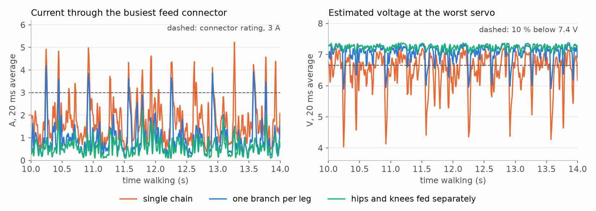

# Power and wiring: two-leg robot, 8 × STS3215

**The robot averages only about 2 A while walking, but its current comes in peaks of 9 A or more, and the stock servo
wiring can't deliver those peaks at full voltage.** Feetech servos are made to be daisy-chained, with power and data
sharing one 3-pin lead. On a chain of 8, every servo's current passes through the leads before it. By this
estimate, the last servo would be more than 10 % below supply voltage for over half of a walk, on servos that have no speed to spare.

The planned fix keeps the data on the daisy chain and takes the power off it. Nothing here has been built or
measured yet: all currents come from simulation, and the wiring resistance is an estimate.

Hardware covered: 6 × STS3215-C001 (1:345) on yaw, roll and pitch, 2 × STS3215-C044 (1:191) on the knees, P08 pelvis,
7.4 V supply, no torso.

## Current per servo

Worst value across the four latest walkers (`r5p_flow`, `r5q_legs_path`, `r4k_cat2_ft`, `r4j_d65_c4_cont`), 20 episodes
each at a 0.15 m/s command, no falls:

| servo (2 of each) | mean | RMS | 99th percentile | peak in sim | plan for |
|---|---|---|---|---|---|
| hip yaw (C001) | 0.11 A | 0.19 A | 0.69 A | 1.5 A | 2.5 A |
| hip roll (C001) | 0.34 A | 0.53 A | 1.9 A | 2.5 A | 2.5 A |
| hip pitch (C001) | 0.30 A | 0.48 A | 1.6 A | 2.5 A | 2.5 A |
| **knee (C044)** | **0.41 A** | **0.83 A** | **3.8 A** | **3.8 A** | **3.8 A** |

The peaks are the servos' stall currents, which are also the simulation's limit, so it can't report anything higher. Roll,
pitch and knee all reach that limit briefly.

## Current for the whole robot

| | current |
|---|---|
| walking mean | 1.8–2.2 A (13–16 W) |
| peak over 20 ms | 9–9.5 A; one rare 14.6 A event with the catwalk policy |
| peak over 2 ms | 11.4–15.6 A |
| one leg stalled | 11.3 A |
| all 8 servos stalled (never seen in sim) | 22.6 A |

## Why a single daisy chain falls short

The table compares three layouts, as a range across the same four walkers. The feed columns describe the busiest
connector feeding a chain. The voltage drop columns describe the worst servo.

| layout | feed RMS | feed peak (20 ms) | time feed is over 3 A | voltage drop, 99th percentile | time more than 10 % low |
|---|---|---|---|---|---|
| single chain through all 8 | 2.2–2.6 A | 9–14.6 A | 12–20 % | 3.1–3.3 V | **51–69 %** |
| one branch per leg | 1.4–1.5 A | 6.3–7.9 A | 3.2–3.6 % | 1.4 V | 5.9–7.5 % |
| **hips and knees fed separately** | 0.8–0.9 A | 4.0–4.7 A | 0.8–1.2 % | 0.4–0.5 V | **under 0.1 %** |



*`r5p_flow`, one episode, 10–14 s into the walk. Voltages are estimates using 0.1 Ω per lead.*

**The main problem is voltage, not a melting connector.** The single chain's RMS current of 2.2–2.6 A is below the
roughly 3 A continuous rating typical of this connector family, so heat is a thin margin rather than an immediate failure.
But a drop in voltage costs both torque and speed, and it happens at the moments the servos need them most. These
servos are already speed-limited: in simulation, raising the supply by 13 % (to 8.4 V) made one walker 46 % faster, so
losing voltage is likely to hurt.

**Giving each leg its own branch helps, but not enough.** It still leaves about 1.4 V of drop, because the knee, the hungriest
servo, sits at the far end of the chain. Feeding the knee separately removes its current from the other leads, and that makes the biggest
difference. Some of the time above 3 A remains, because a knee alone can exceed 3 A; that's unavoidable at its own plug.

## Planned power layout

```
                 ┌── hip feed ───► yaw ─► roll ─► pitch     left leg
 7.4 V ─ fuse ─ pelvis ── knee feed ──────────────► knee
 supply/battery  board
 + bulk cap      ├── hip feed ───► yaw ─► roll ─► pitch     right leg
                 └── knee feed ───────────────────► knee

 data: controller ─► adapter ─► all 8 servos, still one daisy chain
```

| item | recommendation | why |
|---|---|---|
| **supply** | 7.4 V, **15 A peak**, at least 3 A continuous | covers the peaks with margin for the torso, which isn't in these numbers. A bench supply in current-limit mode should be set to 15 A, not 3 A, or it will sag on every step |
| **bulk capacitor** | 1000–2200 µF, at least 16 V, low-ESR, at the pelvis board | absorbs the 2 ms peaks that the tether can't deliver without dropping voltage |
| **tether** | 18 AWG or thicker, at most 1.5 m | at 10 A, 1.5 m of 18 AWG (both conductors, ~0.06 Ω) drops ~0.6 V; 22 AWG would drop ~1.5 V |
| **feeds** | four, as above, 20–22 AWG | separates the knees' current from the hips' |
| **data** | keep the daisy chain | only the signal needs to reach every servo, and it draws almost no current |
| **power breaks** | disconnect VCC on the leads where feeds meet; keep ground and signal connected | otherwise current still flows through the thin leads between feeds. A shared ground keeps the signal referenced |
| **adapter board** | keep it out of the power path | some small boards route servo power through a barrel jack or thin traces rated far below these peaks |
| **fuse** | at the supply, sized once real currents are measured | 8 stalled servos draw 22.6 A, and a short in a moving leg is possible |
| **battery (later)** | 2S LiPo; 450 mAh ≈ 12–15 min of walking at 35C or better, 1000 mAh ≈ 28–34 min at 15C or better | 13–16 W walking; 15 A peaks set the C rating |

A 5 V bench supply is fine for setup and slow routines, but the servos run slower and weaker on it, so a walking policy
trained for 7.4 V won't behave the same.

## Measuring it on the robot

1. **Confirm the knee servo.** The sim uses a C044 on the knee, but [`BOM.csv`](BOM.csv) lists C001 on all four joints. A C001
   would limit the knee to 2.5 A, and it's slower, so the policies would need retesting.
2. **Measure lead resistance.** Load the end of a chain with a known current and measure the voltage at each servo. This replaces
   the 0.1 Ω estimate. Voltage drops scale directly with it, so half that resistance gives about 1.6 V on the single chain.
3. **Log voltage under load.** Read each servo's voltage register during a stepping routine, with an inline power meter on
   the tether, then compare against these tables.
4. **Re-run with the torso.** Retrained policies carry an extra 213 g on a 907 g robot, so expect higher means and more
   time at the servo limits.

## History by policy

| activity (policy) | mean | 99th percentile | peak (20 ms average) | peak (2 ms) | mean power |
|---|---|---|---|---|---|
| quiet stand (`hw_stand_ft`) | **0.4 A** | 0.9 A | 5.9 A* | 6.6 A* | 3 W |
| quiet stand, push-trained (`hw_stand_push`) | 0.7 A | 5.2 A | 10.0 A | 12.5 A | 5.5 W |
| standing on a stepping policy (walkers at zero command) | 1.7–1.9 A | 5.0–5.5 A | 7–9 A | 9–11 A | 12–14 W |
| walking, round 3 (`hw_walk_scratch_stride2`, 0.15 m/s command) | 1.5 A | 4.7 A | 8.9 A | 10 A | 11 W |
| … same gait at 0.05 / 0.10 / 0.20 m/s commands (`hw_walk_scratch_stride`) | 0.7 / 1.1 / 1.6 A | 2.6 / 4.0 / 5.4 A | 8.9–9.6 A | ≤ 10.5 A | 5 / 8 / 12 W |
| walking, warm-started walkers (round-2 gait transferred, 0.07–0.12 m/s) | 1.8–2.2 A | 5.6–6.4 A | 7.7–9.2 A | 9.9–11.7 A | 13–16 W |
| walking, shuffle gait (`hw_walk_scratch`) | 1.1 A | 3.5 A | 8.8 A | 9.5 A | 8 W |
| **walking with real steps, round 4** (`r4j_d65_c4_cont`) | 2.15 A | 6.5 A | 9.0 A | 13 A | 16 W |
| … catwalk style (`r4k_cat2_ft`) / 60 mm hips (`r4n_s60_d65`) | 2.2 / 2.0 A | 6.8 / 6.5 A | 14.6† / 9.0 A | 15.6 / 12.7 A | 16 / 15 W |
| **walking on a line, round 5**, optical flow (`r5p_flow`) / leg odometry (`r5q_legs_path`) | **1.8** / 2.2 A | 6.3 / 6.9 A | 9.1 / 9.5 A | 11.4 / 12.1 A | 13 / 16 W |

\* The quiet-stand peaks happen while the robot settles in the first second after the start pose.
† One rare event in 20 episodes.

- **The gait matters more than the speed.** The round-3 walker scales from 0.7 A at 0.05 m/s to 1.6 A at 0.2 m/s, while
  warm-started walkers draw 1.9–2.0 A at every speed because they keep stepping about 5 times a second. Stepping in
  place costs about 4× the power of a real quiet stance.
- **Real steps cost about 45 % more current** than the skitter, because every step lifts the leg ~2 cm and swings it ~6 cm. The
  hip servos run at their rated torque (RMS ≈ 1.0 × rated), so **expect warm hips in long walking sessions**. Watch the
  temperature register and walk in bouts. The optical-flow walker eases this, to 0.86 × rated. The optical-flow module itself
  adds well under 0.1 A.
- **Knees also run warm:** RMS torque is about 0.8 × rated (1.0 × if the real knee is at the pessimistic end of its torque estimate).

## Supply voltage choice

A full 2S pack is 8.4 V, not 7.4 V. The simulation with the servos scaled to 8.4 V (+13 % speed and torque,
`models/hw_p0v84_8dof`) walked **46 % faster** (0.111 vs 0.076 m/s) and stopped on command twice as often
(50 % vs 26 %), at about the same current (1.9 A mean, 9.2 A 20 ms peak), so ~16 W at 8.4 V.
8.4 V is the top of the LiPo range and above the servos' 7.4 V nominal rating, so check Feetech's absolute maximum for your
units before relying on it. A bench supply at 8.0–8.4 V gets the same benefit for testing.

## How the numbers were made, and their limits

- Motor current I = I_stall × τ / τ_stall from the simulated output torque, with the vendor's stall currents:
  2.5 A for the C001 (2.0 A @ 6 V, scaled), 3.8 A for the C044. Both come from retailer listings.
- Supply current = PWM duty × motor current while the motor is driving (duty and current with the same sign).
  Regenerated (braking) current is ignored, which errs on the safe side. 30 mA per servo is added for its own electronics.
- **Voltage drop** is resistance × current summed along each feed, using an estimated **0.1 Ω per lead** (a 15 cm lead out and
  back, plus its contacts). It has no feedback: real servos would slow down and draw less as voltage falls, so the largest
  drops mean "this won't work", not an exact voltage. The layouts assume equal leads; the real knee lead is longer.
- The single chain is modelled in order through the left leg and then the right. Other chain orders change the drop at each servo.
- **The 3 A connector rating** is typical for 5264-style connectors, not taken from a Feetech document. Check it for your leads.
- **Not modelled:** gearbox friction (real currents are somewhat higher), the MCU and IMU (add ~0.1–0.2 A), the servo
  firmware's current limit and PID (real peaks may be clipped lower), the torso, and falls.
- Physics runs at 2 ms, so "2 ms peak" is the finest resolution. True inrush spikes are shorter and higher,
  which is what the capacitor is for.

Regenerate:
- `.venv/bin/python scripts/power_audit.py <run> --params <ckpt> --test walk40|stand --n 20 [--volts 7.4]` writes `results/power/<run>__<test>.{json,png}`.
- `.venv/bin/python scripts/power_wiring.py [--ohm-per-hop 0.1]` writes `results/power/wiring.json` and `assets/power_wiring.png`.
