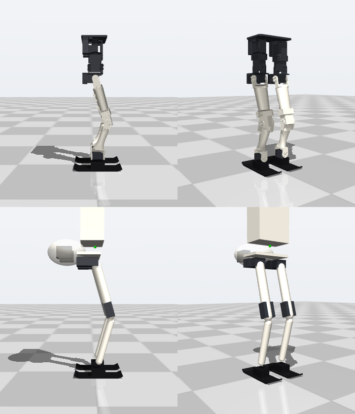

# Round 20: a farther p4, and the flat-hip leg (2026-11-17 01:07-09:00, simulation)

Goal (the operator, after round 19 on the robot): p4 is the most coherent gait so far but the slowest; make it go
farther while keeping its gait and stability. The continuous hip roll (l9 on) is the direction. Then try a new leg
frame: the hip servos lying in a row along the hip plate instead of stacked down the leg, so the thigh and shin take
the leg's whole length and the robot doesn't have to rotate them as far.

GPU: 8 h of the 9 h budget (13 runs of 20-30M from p4, each evaluated). Scripts: `scripts/robot20_common.sh`,
`robot20_queue.sh` .. `robot20_queue4.sh`; the leg: `scripts/make_flathip_model.py`.

## The flat-hip leg (models/hw_flathip_bal_10dof, hw_flathip_10dof)

- **Front to back under the hip plate: pitch / roll / yaw.** The chain stays yaw -> roll -> pitch, so the joint order,
  the policy's inputs and outputs, the gait tables and the robot software carry over unchanged.
  - Hip pitch servo: shaft sideways, body lying fore-aft, its output (the pitch axis) at the front, 22 mm under the
    plate.
  - Hip roll servo: shaft fore-aft, lying sideways behind it. The roll axis is a fore-aft line at the pitch axis'
    height: it now passes through the hip, not 34 mm above it.
  - Hip yaw servo: shaft vertical, fixed to the pelvis 85 mm behind the pitch axis, under a round butt plate (25 g).
    The leg yaws about an axis behind the hip, so yawing also moves the foot sideways (~1.5 mm per degree).
- **Thigh 178 mm, shin 144 mm** (today 138 / 111) at the same height (hip plate to sole, straight leg; standing
  pelvis 370 mm against 373). Robot 1.258 kg (+58 g: longer shells, the butt plate).
- **Less rotation for the same speed.** The p4 gait rebuilt for the new leg (`shift_gait.py --leg 0.1782,0.17625`,
  hip-roll shift 0.115 for the same sideways pelvis travel) swings the hip pitch 29 deg at 0.03 m/s against 36 deg
  today, and needs today's 0.045 m/s swing only at 0.08 m/s.
- **The centre of mass moves back 10 mm** (the yaw servos and the butt behind the hip). With it there, nothing
  walked (`f3_raw`: 0 % up at every speed; from p4 its episodes never got longer). Every other flat-hip run uses
  `_bal`: the torso + head ~42 mm forward, putting the robot's centre of mass where it is today. **A design
  requirement:** move the torso / battery forward, or make the parts behind the hip lighter.
- **The leg is 1.7x harder to swing** (inertia about the hip pitch 121 against 71 x 1e-4 kg m^2: the foot is farther
  from the hip). Its landings were 285-310 mm/s against 255-275 for today's leg on the same recipes. Keep the shin
  and foot light, and put the knee servo high in the thigh (a linkage to the knee) if it can go there.

## Results

All from p4_gate (20M), 20M (q1-q3) or 30M steps. Robot simulator, 48 runs x 20 s, act_lpf 0.7; "cm" is distance
walked in 18 s (median of those up). Loose / slow-hip columns: p4 at 0.015 m/s, q1-q3 at 0.03, the rest at 0.045.

| run | leg | robot sim up % / cm per 20 s at 0.015 · 0.03 · 0.045 · 0.06 m/s | loose (0.03 / 0.045) | slow hips | landing mm/s |
|---|---|---|---|---|---|
| p4_gate | today | 88% 32 · – · – · – | 73% 32 | 81% 30 | 269 |
| f1_bal | flat hip | 92% 31 · 92% 33 · 88% 37 · 67% 46 | 62% 38 | 83% 41 | 299 |
| f2_fast | flat hip | 85% 39 · 90% 39 · 88% 40 · 81% 44 | 58% 41 | 81% 40 | 286 |
| f3_raw | flat hip | 0% 0 · 0% 0 · 0% 0 · 0% 0 | 0% 0 | 0% 0 | 301 |
| f4_t11 | flat hip | 71% 34 · 81% 35 · 73% 38 · 48% 47 | 40% 39 | 58% 42 | 308 |
| f5_v5 | flat hip | 10% 33 · 40% 38 · 52% 41 · 40% 49 | 12% 41 | 54% 36 | 291 |
| g1_str | flat hip | 46% 38 · 77% 37 · 73% 39 · 56% 45 | 19% 39 | 69% 40 | 278 |
| q1_v6 | today | 44% 43 · 69% 43 · 56% 44 · – | 38% 41 | 58% 42 | 265 |
| q2_v6s | today | 71% 39 · 81% 39 · 83% 42 · – | 67% 37 | 56% 42 | 267 |
| q3_t11 | today | 65% 39 · 81% 43 · 88% 44 · – | 33% 40 | 48% 43 | 284 |
| q4_fast | today | 46% 36 · 60% 39 · 52% 42 · 42% 46 | 27% 43 | 48% 50 | 258 |
| q5_str | today | 71% 28 · 65% 33 · 52% 37 · 12% 40 | 6% 38 | 67% 41 | 256 |
| q6_v6 | today | 79% 41 · 75% 42 · 75% 46 · 42% 54 | 23% 46 | 56% 45 | 275 |
| q7_v5 | today | 88% 35 · 98% 39 · 90% 42 · 83% 48 | 46% 43 | 81% 41 | 263 |

The recipes: q1 / f1 = p4's table with rows to 0.06 (f: to 0.08), commands 0.02-0.06, progress x2; q2 = q1 + pay
strides to 70 mm; q3 / f4 = 1.1 s steps; q4 / f2 = commands 0.03-0.08; q5 / g1 = q4 / f2 + pay strides to 100 mm;
q6 = f1's recipe on today's leg at 30M; q7 / f5 = q1 / f1 continued at a fixed 0.05-0.06.

Matched pairs (same recipe and steps, only the leg differs):

| pair | flat hip | today's leg |
|---|---|---|
| f1_bal / q6_v6 (0.02-0.06) | **88-92 % up**, loose 62 %, slow 83 %; 31-37 cm | 75-79 % up, loose 23 %, slow 56 %; **41-46 cm** |
| f2_fast / q4_fast (0.03-0.08) | **81-90 % up**, loose 58 %, slow 81 %; 39-44 cm | 42-60 % up, loose 27 %, slow 48 %; 36-46 cm |
| f5_v5 / q7_v5 (fixed 0.05-0.06) | 10-52 % up, loose 12 %, slow 54 %; 33-49 cm | **83-98 % up**, loose 46 %, slow 81 %; 35-48 cm |

## What it shows

- **No policy on either leg walks at its command above ~0.025 m/s.** Every one of the 13 settles at 30-54 cm per
  18 s (17-30 mm/s) whatever it is asked: at 0.06 m/s the table asks for 108 cm. Neither the leg, paying for
  progress (x2) or stride (to 70 / 100 mm), nor quicker steps (1.1 s) changed that; the stride rewards and 1.1 s
  steps cost stability on both legs. The limit is in how these fine-tunes from p4 learn, not in either leg's reach.
- **The flat-hip leg did not walk farther.** On the same recipe it went as far or less; it was more robust in 2 of
  3 pairs and failed the third (f5), so on one seed each the robustness edge is not established.
- **The best "farther p4" is q7_v5** (today's leg): 98 % up and 39 cm at 0.03 m/s, 90 % and 42 cm at 0.045, 81 %
  with slow hips. p4 does 32 cm at 0.015 and 35 cm at 0.03 (90 %). It is p4's gait with ~20 % more ground; loose
  hips 46 % (p4: 73 % at 0.015), so it may be shakier on the robot.
- 1.1 s steps (q3, f4) lost stability on both legs without gaining ground.

## Next

- Robot: q7_v5 against p4 at the same `--vx`.
- The speed ceiling: a longer run from scratch or a command curriculum that only raises the command once the
  policy keeps up, rather than fine-tunes from p4's slow gait; and more than one seed per pair before calling a
  leg design better.
- The flat-hip leg: worth building only with the centre of mass kept over the hips and a light shin / foot; in
  simulation it has not yet shown a speed gain.

## To test on the robot

All `--enable --act-lpf 0.7 --video`.

1. `python policy_stand.py run --run q7_v5 --params params_0030M.pkl --enable --vx 0.03 --act-lpf 0.7 --video`,
   then the same at `--vx 0.045`.
2. Baseline, same session: `python policy_stand.py run --run p4_gate --enable --vx 0.03 --act-lpf 0.7 --video`
   (p4 at twice its usual command: 35 cm and 90 % up in simulation).
3. `python policy_stand.py run --run q2_v6s --enable --vx 0.03 --act-lpf 0.7 --video` (81 % up, 39 cm; slow
   hips 56 %).

Watch: does q7 keep p4's coherent rolling gait? Is it visibly farther per step? Falls per step against p4's 0 in 115.

## Why the flat hip doesn't walk faster (follow-up, 2026-11-17 09:30)

CPU simulation, robot-like settings, f1_bal (flat hip) and q6_v6 (today's leg, same recipe), 4 seeds each:

| | f1_bal 0.045 | f1_bal 0.06 | q6_v6 0.045 | q6_v6 0.06 |
|---|---|---|---|---|
| speed, mm/s | 19 | 25 | 22 | 27 |
| hip pitch swing: table / commanded / measured, deg | 31 / 34 / 34 | 33 / 37 / 37 | 39 / 40 / 40 | 42 / 44 / 44 |
| swinging board's real travel / the table's, mm | 42 / 108 | 61 / 144 | 43 / 108 | 54 / 144 |
| board in the air, s (table 0.55) | 0.36 | 0.36 | 0.36 | 0.36 |

- **The policies don't shrink the stride.** The commanded hip pitch swings as far as the table asks, or further, and
  the joints follow it. The leg makes the big stride in its joints; the robot doesn't travel it.
- **The table is stop-and-go for the body.** Relative to the planted foot, c_F1v8 / c_Q1v6 hold the pelvis still for
  60 % of the cycle (double support and the weight shift) and move it only during each swing, at up to 243 mm/s
  for a 45 mm/s command (5x). It is the step-and-settle design these tables come from (shift, swing the board
  forward and the stance board back by the same, settle).
- **The robot can't follow that surge on flat boards without ankle pitch, so it rocks.** In a cycle at 0.045 m/s
  the pelvis moves back 14 mm after a landing, forward 17 mm in the swing, forward 48 mm in double support, back 22
  mm in the next swing, pitching 0-10 deg. At lift-off the foot is still 27 mm ahead of the pelvis (the table: 18
  mm behind): the body never gets over it. ~40 % of every surge is given back; that is the 17-30 mm/s ceiling on
  both legs. The flat hip's longer reach only makes the surge bigger.
- **What would use the longer leg:** a reference whose pelvis moves at a constant speed through the whole cycle (the
  stance foot sweeping back steadily in double support too), keeping p4's swing, shift and held transfer. Round
  18's walk tables had a constant pelvis speed but changed the swing and sway at the same time and didn't train
  from l9 in 8M steps.

## On the robot (2026-11-17 10:25-10:31, 6 trials)

User: q7 doesn't work: it trips on the first step, and even helped through that it falls within a few steps. q2
seems to work but is quite unstable; its walk looks like k5's. p4 remains the most stable, smooth and continuous,
albeit slow.

`swing_clear.py`, `gait_metrics.py` (gate share fixed, see below). The logs don't record `--vx`; fitting the
commanded hip pitch to the table rows gives the same command for all six trials, a little above round 19's p4 at
0.015, which fits the test list's 0.03 (the policies flatten the stride).

| run | trials | falls / touchdowns | stride mm | s / step | speed mm/s | roll / pitch p2p deg | legs apart at lift-off (table 14.9): cmd / measured | body pitch at lift-off | gate held |
|---|---|---|---|---|---|---|---|---|---|
| **p4_gate** | 2 | 0 / 78 (48 s, 52 s, stopped up) | 42 | 1.24 | 17 | 12.6 / 7.3 | 21 / 17 | +1.7 | 5 % |
| q2_v6s | 1 | 1 / 26 (fell left at 34 s) | 39 | 1.30 | 15 | 13.6 / 9.1 | 18 / 14 | +3.9 | 7 % |
| q7_v5 | 3 | 3 / 24 (two forward at 2.6 s, one right at 27 s) | 45 | 1.22 | 18 | 11.2 / 8.5 | 11 / 7.6 | +2.5 | 8 % |

- **p4 at the higher command is p4 a little faster:** stride 34 -> 42 mm, 14 -> 17 mm/s, still no falls in 78 steps.
- **q7 skips the weight shift.** Trained only at 0.05-0.06 m/s, its residual cancels a third of the table's shift
  (commands 11 deg of leg spread at lift-off against the table's 15 and p4's 21; measures 7.6 against 17). It
  lifts the foot with the weight still between the feet. Both first-step falls are the same: the body is pitched
  forward 7-9 deg when the left foot lifts, the fast left swing (16 -> 50 deg hip pitch in 0.2 s, the same as p4's)
  pitches it back to -4.6, and after the left landing it pitches forward to 18 deg and goes over. Its swings are not
  more aggressive than p4's (peak hip pitch 51 / 52 deg, 184 deg/s both); the body is less settled under them
  (pitch up to 12 deg after a landing, p4 8). The simulator scored it best of the round (98 %): another policy the
  simulator overrates, and the cue was in the numbers: fine-tuned at one high command, it had the least shift.
- **q2 is k5-like:** less shift (14 deg), the body pitched forward at lift-off (+3.9), more pitching (9 deg p2p),
  longer steps (1.30 s), and no faster than p4 on the robot (15 mm/s).

**Correction to rounds 18-19:** the log's `gate_held` counts how long the current hold has lasted. Averaged, it
gave n15 14-31 %, l9 19 %, p1 / p4 6-8 %. The share of time held is k5 1.9 %, l9 4.3 %, n15 5.6 %, p1 2.5 %, p4
3.2 % (tonight p4 5 %, q2 7 %, q7 8 %). Fixed in gait_metrics.py and noted in the round-18/19 docs.

**Verdict:** p4 stays the walker; run it at the higher command. On the robot, speed from the policies so far comes
only with less weight shift, and that is what breaks them (q7, q2, and n15's opposite failure was too much). The
next speed gain has to come from the reference: a pelvis that moves at a constant speed (the stop-and-go surge
above), with p4's shift kept.

**Follow-up: q7 and q2 shift late, not less.** Legs apart (hip roll L - R, measured, median over lift-offs) from
0.3 s before to 0.4 s after lift-off:

| | -0.3 | -0.2 | -0.1 | lift-off | +0.1 | +0.2 | +0.3 | +0.4 s |
|---|---|---|---|---|---|---|---|---|
| p4 | 1.4 | 4.8 | 10.5 | **16.8** | 21.2 | 23.5 | 24.5 | 25.4 |
| q2 | 2.8 | 3.3 | 7.9 | **14.3** | 18.5 | 21.4 | 23.0 | 24.0 |
| q7 | 2.7 | 1.9 | 3.5 | **7.6** | 11.5 | 14.9 | 18.8 | 21.2 |

All three reach the same ~21-25 deg. p4 is nearly there when the foot lifts; q7 gets there 0.3-0.4 s later, with
the foot already in the air (the swing lasts 0.55 s); q2 is ~0.1 s late. The commands show the same lag, so it is
the policy, not the servos. The CPU simulator shows the same ordering (commanded spread at lift-off: p4 22.6, q2
20.4, q7 14.6 deg) and still keeps q7 up, also with the robot's slow hip ramps (slow-hip simulation: 81 % up). So the
simulator's hip-roll speed doesn't explain it (an earlier version of this note said it did); why the simulator
tolerates a late shift is open. They also bought almost no speed with it on the robot (q7 18 mm/s, q2 15, p4 17).
`gait_eval.py` now prints the legs' spread at the real lift-off (simulation: p4 30 deg, q7 22.5).
